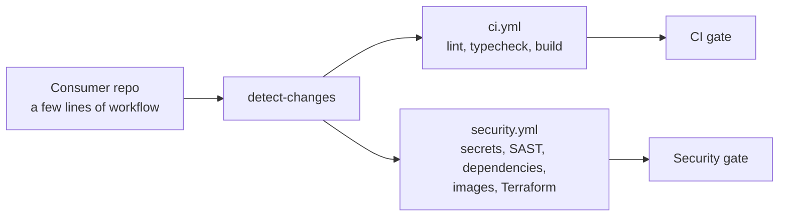

# Checks Toolkit

[](https://github.com/ops-lane/checks-toolkit/actions/workflows/self-test.yml)

Reusable GitHub Actions workflows that give a repository CI and security
checks, with almost no configuration. A repository adds a few lines that call
the workflows; the platform works out which technologies are present, what
changed in a pull request, and runs only the checks that are relevant.

> **Status: pre-1.0.** It works, but the interface can still
> change between versions, and not everything has been proven end to end on
> GitHub yet. [docs/roadmap.md](docs/roadmap.md) says exactly what is verified
> and what is not.

## Why

Most repositories copy the same CI configuration around and let it drift, and
security scanning tends to be added late, if at all. Here the logic lives in
one place and consumer repositories only say *that* they use it:

- **Detection, not configuration.** It finds Python, Node, Docker, Terraform
  and Markdown on its own, per directory, so monorepos work.
- **Only what is relevant runs.** A change to a README does not run the
  Python checks, but the secret scan still runs.
- **Security is part of the pipeline**, not an extra: secrets, static
  analysis, dependencies, container images and Terraform misconfigurations,
  with a severity policy (critical and high block, the rest is reported).
- **Two required checks.** A consumer repository only needs `CI gate` and
  `Security gate`; whatever runs inside can change without touching it.



## Quick start

In the consumer repository, for example `.github/workflows/checks.yml`:

```yaml
name: Checks

on:
  pull_request:
    # labeled/unlabeled: so adding or removing the skip-ci label starts a new run
    types: [opened, synchronize, reopened, labeled, unlabeled]

permissions:
  contents: read

jobs:
  ci:
    # Granted on the calling job, not the whole workflow: the gate reads the
    # run's jobs for its result table and posts a comment on the pull request.
    permissions:
      contents: read
      actions: read
      pull-requests: write
    uses: ops-lane/checks-toolkit/.github/workflows/ci.yml@v0.1.0
    with:
      platform-ref: v0.1.0   # must equal the version after the @ above

  security:
    permissions:
      contents: read
      actions: read
      pull-requests: write
    uses: ops-lane/checks-toolkit/.github/workflows/security.yml@v0.1.0
    with:
      platform-ref: v0.1.0
```

**CodeQL is off by default.** It only works on a public repository or one with GitHub Advanced Security, and fails on any other private repository, so it has to be switched on deliberately: add `codeql: true` to the `security` job's `with:`. Semgrep always runs.

Then make **`CI gate`** and **`Security gate`** the required checks in branch
protection. Pin to a release tag, never to a branch. `v0.1.0` is the first
release that contains `security.yml`; see [CHANGELOG.md](CHANGELOG.md).

Why `platform-ref` has to repeat the version, what the inputs do and what the
permissions are for: [docs/workflows.md](docs/workflows.md).

## What it checks

| Capability | CI | Security |
|---|---|---|
| Python | Ruff, mypy | pip-audit |
| Node | ESLint, `tsc` | `npm audit`, `pnpm audit` |
| Docker | `docker build` | Trivy image scan |
| Terraform | `terraform fmt -check` | Trivy misconfiguration scan |
| Markdown | markdownlint, codespell, lychee | — |
| Workflows | actionlint | zizmor (report only) |
| Whole repository | — | Gitleaks (always), Semgrep, and CodeQL once switched on (see below) |

Every check is also a standalone composite action in [`actions/`](actions/),
each with its own README, so a single one can be used without the rest.

A maintainer can switch everything off for one pull request with the
`skip-ci` label; the gates then report that nothing was checked instead of
staying pending.

## Security

The scanners parse untrusted code from pull requests, so they run in
throwaway containers pinned by digest, and the workflows follow the rules a
public CI platform needs: pinned actions, no expression interpolated into a
script, no credentials left on disk, and a refusal to run on
`pull_request_target`. The details and the reasoning are in
[docs/security.md](docs/security.md). To report a vulnerability, see
[SECURITY.md](SECURITY.md).

## Documentation

| | |
|---|---|
| [docs/architecture.md](docs/architecture.md) | How the pieces fit, and what is deliberately out of scope |
| [docs/workflows.md](docs/workflows.md) | The interface: inputs, outputs, schema, the `skip-ci` label |
| [docs/security.md](docs/security.md) | Security layers, severity policy, how scans are isolated |
| [docs/decisions.md](docs/decisions.md) | Why things are the way they are |
| [docs/roadmap.md](docs/roadmap.md) | What works, how well it is verified, what is next |
| [docs/runners.md](docs/runners.md) | Runners and trust boundaries |
| [docs/contributing.md](docs/contributing.md) | Conventions and rules for changing it |

## Contributing

Issues and pull requests are welcome; read [CONTRIBUTING.md](CONTRIBUTING.md)
first. This is a small project with a single maintainer, so replies may take
a while.

## License

Released under the MIT License; see the `LICENSE` file.
