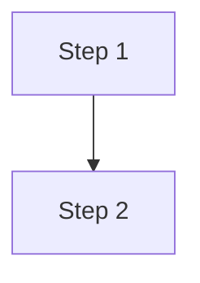

<!--
Template for actions/<name>/README.md. Copy this into a new action's
folder once the action is actually finished (real tooling implemented and
tested), not for still-placeholder skeletons. Delete this comment block
and fill in every section — remove a section only if it genuinely doesn't
apply (e.g. an action with no inputs).
-->

# `<action-name>`

<One or two sentences: what this action checks/does, and for which capability/target (see the `<type>-<target>` naming convention in [contributing.md](../../docs/contributing.md)).>

**Origin:** In-house (built for this platform, no third-party Action wrapped)
<!-- OR, if it wraps something external:
**Origin:** Wraps the official [`<owner>/<repo>`](https://github.com/<owner>/<repo>) Action, published by <vendor> — allowed per the [Actions policy](../../docs/contributing.md#actions-policy) (official/verified publisher).
-->

## Inputs

| Name | Required | Default | Description |
|---|---|---|---|
| `<input-name>` | No | `<default>` | `<description>` |

<If there are no inputs: "This action takes no inputs.">

## Outputs

| Name | Description |
|---|---|
| `<output-name>` | <description, including the JSON shape if it's a JSON string> |

<If there are no outputs: "This action produces no outputs; it succeeds or fails.">

## How it works



<Add a second diagram if there's a genuinely separate piece of logic worth visualizing (e.g. a decision tree), rather than cramming everything into one diagram.>

## Usage

```yaml
- uses: ./actions/<action-name>
  with:
    <input-name>: <value>
```

## Known issues / Limitations

- <Known limitation, with a pointer to the Known limitations in docs/roadmap.md or the decisions.md row if one exists — don't duplicate the full reasoning here, link to it.>

## Related documentation

- [decisions.md](../../docs/decisions.md) — decisions specific to this action, if any
- [workflows.md](../../docs/workflows.md) — the platform-wide schema/contract this action fits into
