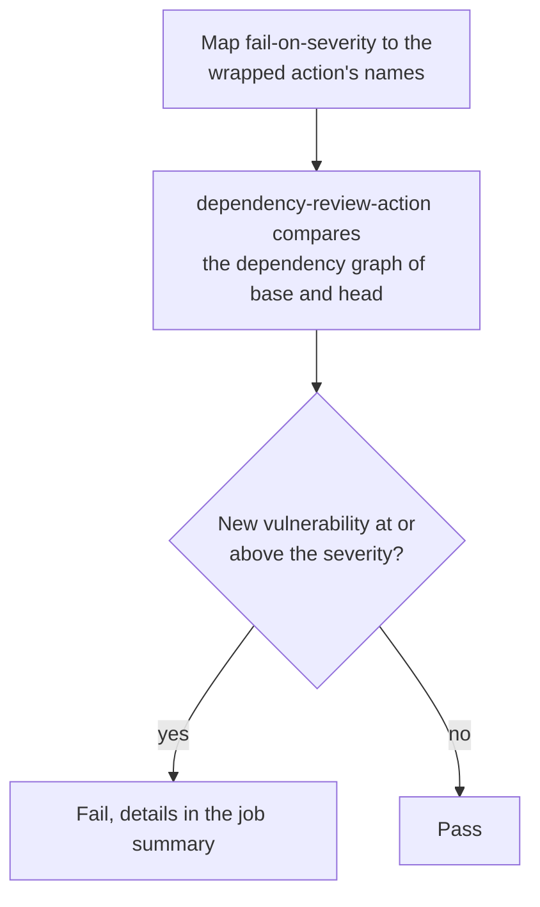

# `audit-dependencies`

Reviews the dependencies a pull request **adds or changes** and fails when one of them brings in a known vulnerability at or above `fail-on-severity`. The other `audit-*` actions look at everything a project already depends on; this one looks only at what the change introduces, across every ecosystem GitHub's dependency graph supports, including the GitHub Actions a workflow uses.

**Origin:** Wraps the official [`actions/dependency-review-action`](https://github.com/actions/dependency-review-action), published by GitHub, pinned by commit SHA — allowed per the [Actions policy](../../docs/contributing.md#actions-policy) (official publisher).

## Inputs

| Name | Required | Default | Description |
|---|---|---|---|
| `fail-on-severity` | No | `high` | Lowest severity of a newly introduced vulnerability that fails the step: `critical`, `high`, `medium`, `low`, or `none` (never fail, report only). |
| `base-ref` | No | `""` | Commit SHA or ref to compare from. Empty uses the base of the pull request. Needed to run outside a pull request. |
| `head-ref` | No | `""` | Commit SHA or ref to compare to. Empty uses the head of the pull request. |
| `token` | No | `github.token` | Token for the GitHub API (the dependency graph comparison). Needs `contents: read`. |

## Outputs

| Name | Description |
|---|---|
| `vulnerable-changes` | The added or changed dependencies with a known vulnerability, as JSON (an empty list when there are none). |

## How it works



The platform says `critical`/`high`/`medium`/`low`/`none` in every action; the wrapped action says `low`/`moderate`/`high`/`critical` and has no `none`, so `medium` becomes `moderate` and `none` becomes its warn-only mode.

Licenses are deliberately switched off here (`license-check: false`): [`scan-licenses`](../scan-licenses/README.md) owns that question. The result is written to the job summary and no pull request comment is posted, so the job does not need `pull-requests: write`.

## Usage

```yaml
on:
  pull_request:

permissions:
  contents: read

jobs:
  audit-dependencies:
    runs-on: ubuntu-latest
    steps:
      - uses: actions/checkout@3d3c42e5aac5ba805825da76410c181273ba90b1 # v7.0.1
        with:
          persist-credentials: false

      - uses: ./actions/audit-dependencies
```

## Known issues / Limitations

- **Needs the dependency graph.** On a public repository it is on; on a private one it needs GitHub Advanced Security, and without it the step fails with an explanation. That is why it is not part of `security.yml` and has to be called deliberately.
- **Only what the change adds.** A vulnerability that was already there is not reported; use `audit-node` and `audit-python` for the full picture.
- **Depends on GitHub's advisory data and on the graph being up to date,** so a very fresh advisory or a lock file GitHub cannot parse may be missed.
- **Pull requests only, by default.** Outside a `pull_request` event both refs have to be passed.
- **Not part of `ci.yml` or `security.yml`.** This repository runs it from its own `dependency-review.yml`; offering it to consumers is a later step.
- **Not run on GitHub yet.** The wrapped action is configured from its documented inputs; it runs for the first time on the first pull request after `dependency-review.yml` is merged.

## Related documentation

- [decisions.md](../../docs/decisions.md) — "Dependency review is a separate action"
- [scan-licenses](../scan-licenses/README.md) — the license half of the same question
