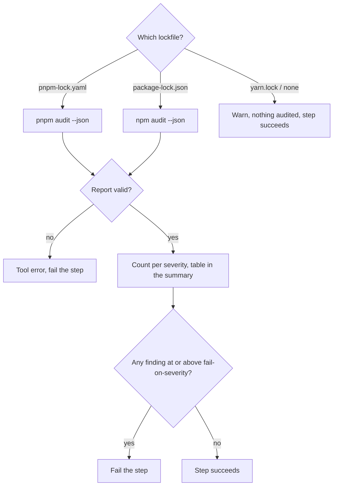

# `audit-node`

Checks Node dependencies for known vulnerabilities with `npm audit` or `pnpm audit`, chosen from the lockfile that is present. Reads the lockfile only — nothing is installed. The step fails when a finding at or above `fail-on-severity` exists; every finding is listed in the job summary.

**Origin:** In-house composite action that calls the package manager's own audit directly (not a wrapped GitHub Action) — allowed per the [Actions policy](../../docs/contributing.md#actions-policy) (the ecosystem's own tool). See [decisions.md](../../docs/decisions.md), row "Dependency (SCA) scanning strategy".

## Inputs

| Name | Required | Default | Description |
|---|---|---|---|
| `working-directory` | No | `.` | Directory to audit — one component's `path` from `detect-changes`' `components[]`. |
| `fail-on-severity` | No | `high` | Lowest severity that fails the step: `critical`, `high`, `moderate` (or `medium`, the same), `low`, or `none` (report only). |

## Outputs

| Name | Description |
|---|---|
| `manager` | `npm`, `pnpm`, or `none` (no supported lockfile). |
| `vulnerability-count` | Total findings. npm counts vulnerable **packages**, pnpm counts **advisories**, so the number is not comparable across the two. |
| `result` | Counts per severity as JSON: `{info, low, moderate, high, critical, total}`. |

## How it works



Both tools exit non-zero when they find something, so the exit code cannot tell "found vulnerabilities" from "could not run". Success is judged on the output: a report with `metadata.vulnerabilities` means the audit ran.

## Usage

```yaml
- uses: ./actions/audit-node
  with:
    working-directory: frontend
    fail-on-severity: critical
```

## Known issues / Limitations

- **yarn is not supported yet.** With only a `yarn.lock` the action warns and audits nothing.
- **No lockfile, no audit.** Without `package-lock.json`/`pnpm-lock.yaml` there are no exact versions to audit; the action warns and succeeds. A silent pass is possible here, so look for the warning.
- **Needs the network** to reach the registry's advisory data.
- **Verified locally** with vulnerable sample projects for npm and pnpm; not yet run on a GitHub runner.

## Related documentation

- [decisions.md](../../docs/decisions.md) — "Severity policy in the security actions"
- [security.md](../../docs/security.md) — severity policy
