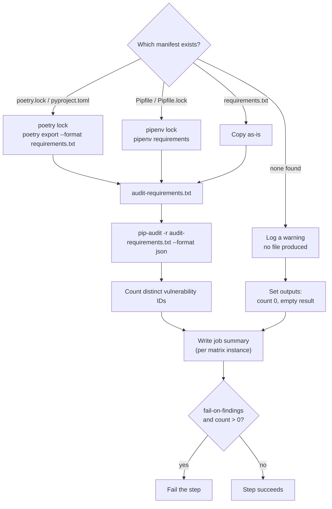

# `audit-python`

Checks Python dependencies for known vulnerabilities, regardless of whether the project uses pip, Poetry, or Pipenv. Reports findings as outputs and in the job summary. By default the step never fails on a finding — only on a genuine `pip-audit` execution error — but `fail-on-findings` can turn any finding into a hard failure.

**Origin:** In-house composite action that installs and calls the official [PyPA `pip-audit`](https://github.com/pypa/pip-audit) CLI tool directly (not a wrapped GitHub Action) — allowed per the [Actions policy](../../docs/contributing.md#actions-policy) (official ecosystem-authority tool). See [decisions.md](../../docs/decisions.md), row "Dependency (SCA) scanning strategy".

## Inputs

| Name | Required | Default | Description |
|---|---|---|---|
| `working-directory` | No | `.` | Directory to run in — one component's `path` from `detect-changes`' `components[]` when auditing a specific spot in a monorepo. Implemented via the step-level `working-directory:` key, so every relative path inside this action (the manifest files, `audit-requirements.txt`) resolves against it automatically. |
| `fail-on-findings` | No | `false` | Fail the step when vulnerabilities are found. `pip-audit` has no severity field (see Known issues), so this is an all-or-nothing switch, not a severity threshold — there's no "fail only on critical" option today. |

## Outputs

| Name | Description |
|---|---|
| `manager` | Which package manager was detected: `poetry`, `pipenv`, `pip`, or `none`. |
| `vulnerability-count` | Number of **distinct** vulnerabilities found (deduplicated by ID — `pip-audit` can list the same vulnerability more than once, once per advisory source). `0` if clean or if no recognized dependency file was found. |
| `result` | Raw `pip-audit --format json` output: `{ "dependencies": [{ "name", "version", "vulns": [{ "id", "fix_versions", "aliases", "description" }] }], "fixes": [] }`. **Does not include a severity/CVSS field** — confirmed by testing, not just assumed (see Known issues). |

## How it works



Whichever package manager is detected, the dependency set is always normalized to a plain `audit-requirements.txt` file before `pip-audit` ever runs — `pip-audit` then always does the exact same thing (`-r audit-requirements.txt`), regardless of which manager produced that file. This is deliberate: `pip-audit` with no arguments audits the *entire active environment*, which would also report on `pip` itself and `pip-audit`'s own installed dependencies — noise unrelated to what the project actually declared (see [decisions.md](../../docs/decisions.md) for the fuller reasoning trail).

## Usage

```yaml
- uses: ./actions/audit-python
  id: audit
```

```yaml
# Against one component in a monorepo (path from detect-changes' components[])
- uses: ./actions/audit-python
  id: audit
  with:
    working-directory: backend
```

## Known issues / Limitations

- **No severity field.** `pip-audit`'s JSON output has no CVSS/severity rating per vulnerability — confirmed from real test output (`id`/`fix_versions`/`aliases`/`description` only). This is also why `fail-on-findings` is all-or-nothing: there's no data to build a graded "fail on critical/high, report on medium/low" policy on top of. A future severity-aware policy will need another data source, not this action's `result` output as-is.
- **Lockfiles are regenerated, not trusted as committed.** For Poetry/Pipenv projects, this action runs `poetry lock`/`pipenv lock` itself rather than using a possibly-already-valid committed lockfile — makes the action self-sufficient (no precondition on the caller's checkout), but means every run re-resolves against PyPI, and the resolved set can differ slightly from whatever was last actually deployed if compatible newer versions were published since.
- **Fails on findings only if you opt in.** By default (`fail-on-findings: false`, pip-audit has no severity field, so there is no threshold to apply; see "Severity policy in the security actions" in decisions.md) a green step can still contain vulnerabilities — always check `vulnerability-count` or the job summary rather than the step's own pass/fail color. Set `fail-on-findings: true` to make any finding block the step; a failing matrix instance still lets sibling components finish (see [workflows.md](../../docs/workflows.md)'s `fail-fast: false` matrix setup in `security.yml`, where this action now runs), and the calling job's own status already reflects the failure — no separate aggregation step is needed to detect it.
- **Needs network access.** `poetry lock`/`pipenv lock` and `pip-audit` itself all query PyPI/OSV over the network; won't work on an isolated/offline self-hosted runner without a registry mirror.
- **`--break-system-packages --ignore-installed` needed for every install.** Required to work around PEP 668 ("externally managed environment") and Debian/Ubuntu-packaged Python tools colliding with pip. Confirmed on a real GitHub-hosted runner for the pip and Pipenv branches (`checks-toolkit-test` run 37137766289). The Poetry branch failed there: `poetry self add poetry-plugin-export` exits 0 but installs where Poetry never loads it, so `poetry export` didn't exist. The plugin is now installed with pip next to Poetry (verified in a clean non-root `ubuntu:24.04` container); a real runner confirmed that fix (`checks-toolkit-test` run 37138179824). All three package-manager branches are now verified on a GitHub-hosted runner.

## Related documentation

- [decisions.md](../../docs/decisions.md) — "Dependency (SCA) scanning strategy", "Security actions report, don't gate"
- [workflows.md](../../docs/workflows.md) — actions overview and capability → CI mapping
