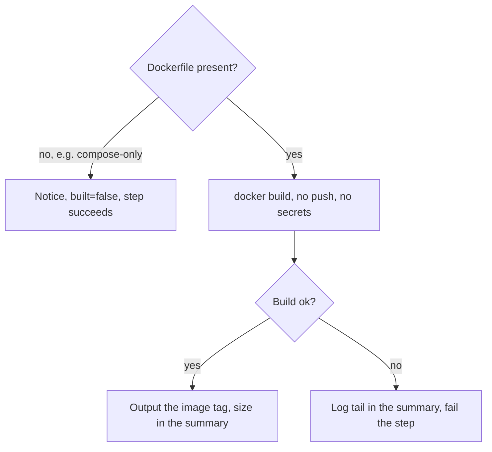

# `build-docker`

Builds a component's Docker image to prove it builds, and returns the image tag so `scan-docker` can scan it. Never pushes, never passes secrets or build arguments. The step fails when the build fails; the end of the build log is in the job summary.

**Origin:** In-house composite action around plain `docker build` (preinstalled on GitHub-hosted runners) — no Action wrapped.

## Inputs

| Name | Required | Default | Description |
|---|---|---|---|
| `working-directory` | No | `.` | Directory used as the build context — one component's `path` from `detect-changes`' `components[]`. |
| `dockerfile` | No | `Dockerfile` | Dockerfile name inside the working directory. |

## Outputs

| Name | Description |
|---|---|
| `image` | Local tag of the built image (`ci-build/<path-slug>:<commit>`), empty when nothing was built. |
| `built` | `true` if an image was built, `false` if the directory has no Dockerfile. |

## How it works



## Usage

```yaml
- id: build
  uses: ./actions/build-docker
  with:
    working-directory: services/api

- uses: ./actions/scan-docker
  with:
    image: ${{ steps.build.outputs.image }}
```

## Known issues / Limitations

- **The Dockerfile's `RUN` steps execute on the runner.** Nothing is passed in (no secrets, no build args), but it is code from the pull request — another reason this belongs on an ephemeral runner. See [security.md](../../docs/security.md#how-the-scans-run).
- **Built twice** in the platform: once by `ci.yml` and once by `security.yml`, because separate workflows cannot share a local image. See [decisions.md](../../docs/decisions.md), row "What lives in `ci.yml` versus `security.yml`".
- **No layer caching, single platform.** `docker/build-push-action` would add both; not needed yet.
- **Verified locally** (build, compose-only skip); not yet run on a GitHub runner.

## Related documentation

- [workflows.md](../../docs/workflows.md) — actions overview and capability → CI mapping
