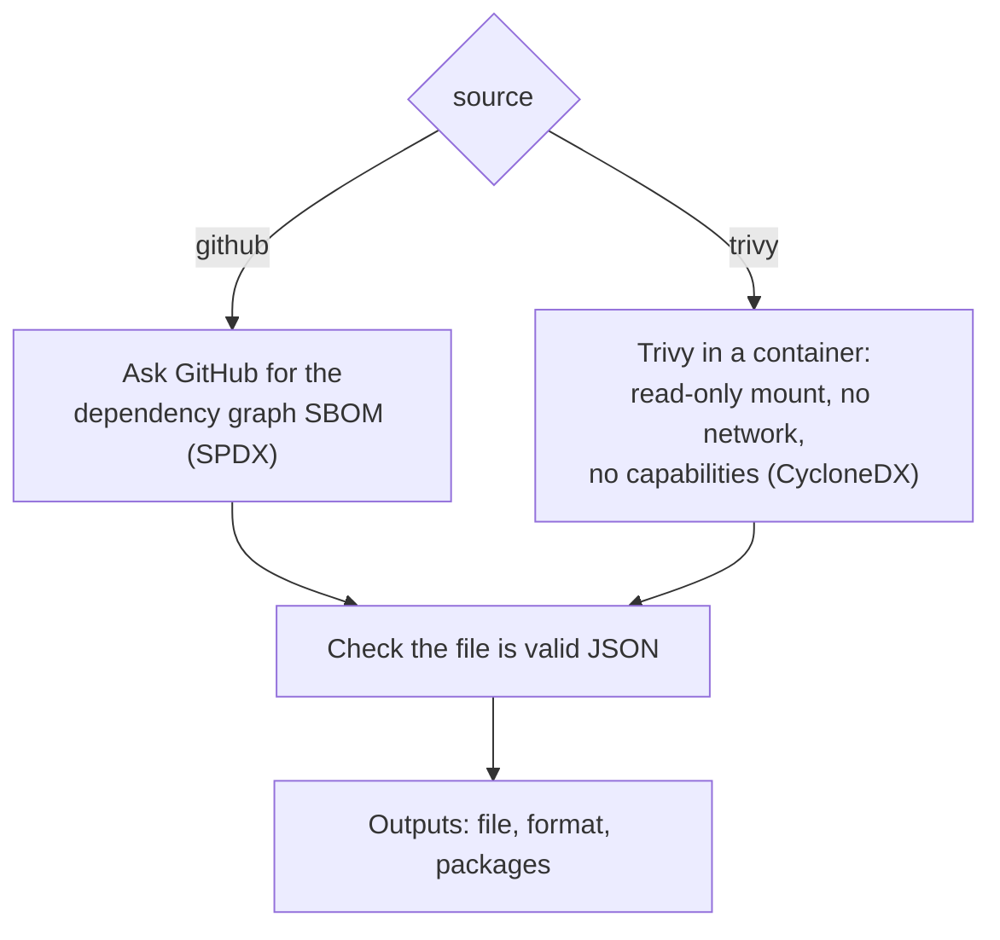

# `build-sbom`

Writes a software bill of materials (SBOM) for the repository to a file: the list of the components the project is built from. It takes the list either from GitHub's dependency graph (SPDX) or from the files with Trivy (CycloneDX). It only writes the file; attaching it to a release or attesting it is up to the caller, as the `Release` workflow of this repository does.

**Origin:** In-house composite action; the GitHub CLI (`gh`) for the dependency graph, or the official [Trivy](https://github.com/aquasecurity/trivy) container image, pinned by version and digest (the same image as `scan-docker`). No third-party Action.

## Inputs

| Name | Required | Default | Description |
|---|---|---|---|
| `source` | No | `github` | Where the SBOM comes from: `github` (the repository's dependency graph, SPDX JSON) or `trivy` (Trivy reads the lock files and installed packages, CycloneDX JSON). |
| `output` | No | `""` | Path of the file to write. Defaults to `sbom.spdx.json` or `sbom.cdx.json` in the runner's temporary directory. A relative path is relative to the workspace. |
| `working-directory` | No | `.` | Directory Trivy reads (`source: trivy` only). |
| `token` | No | `github.token` | Token for the GitHub API (`source: github` only). Needs `contents: read`. |

## Outputs

| Name | Description |
|---|---|
| `file` | Absolute path of the SBOM file that was written. |
| `format` | The SBOM format: `spdx-json` or `cyclonedx-json`. |
| `packages` | The number of packages in the SBOM. |

## How it works



The `github` source needs nothing to be scanned and covers every ecosystem GitHub's dependency graph supports, **including the GitHub Actions a repository uses**, which is why it is the default and what suits a repository made of workflows. The `trivy` source reads lock files and installed packages and is the one for an application.

## Usage

```yaml
permissions:
  contents: read

steps:
  - uses: ./actions/build-sbom
    id: sbom

  - run: echo "SBOM at $SBOM_FILE"
    shell: bash
    env:
      SBOM_FILE: ${{ steps.sbom.outputs.file }}
```

```yaml
# From the files, for an application with lock files
- uses: actions/checkout@3d3c42e5aac5ba805825da76410c181273ba90b1 # v7.0.1
  with:
    persist-credentials: false

- uses: ./actions/build-sbom
  with:
    source: trivy
    output: sbom.cdx.json
```

## Known issues / Limitations

- **The `github` source is only as complete as the dependency graph.** For a repository that uses a few Actions it lists those and little else, and a very recent change may not be in the graph yet.
- **The `trivy` source reads what is in the files.** Lock files and installed packages give components; a project without either gives an empty SBOM. It is not run with a vulnerability scan, so the SBOM carries no advisories.
- **No signing or attestation here.** The action writes the file; the release workflow attests it.
- **Verified locally** with both sources: this repository's dependency graph, and a lock file with one dependency through Trivy.

## Related documentation

- [security.md](../../docs/security.md#verifying-a-release) — how a release and its SBOM are attested and verified
- [scan-licenses](../scan-licenses/README.md) — the same Trivy image, reading licenses
