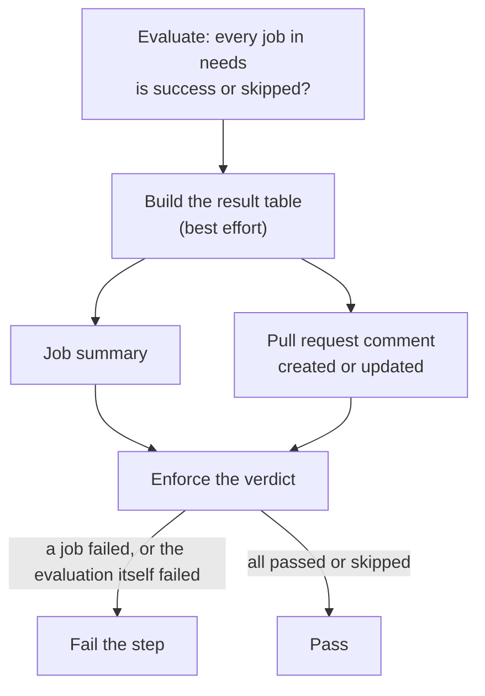

# `ci-gate`

Turns the results of a workflow's jobs into one verdict: it fails when any job failed, and reports a per-step result table in the job summary and, on pull requests, as a sticky comment. This is the action behind the `CI gate` and `Security gate` checks that a consumer repository makes required.

**Origin:** In-house composite action; the GitHub CLI (`gh`) and `jq` that are preinstalled on GitHub-hosted runners, no third-party Action.

## Inputs

| Name | Required | Default | Description |
|---|---|---|---|
| `needs` | Yes | — | The calling job's `needs` context as `toJSON(needs)`. A composite action cannot read the `needs` context itself. |
| `name` | No | `CI` | Name of the workflow this gate belongs to (`CI`, `Security`). It titles the result table, keeps the sticky comments of different workflows apart, and finds this workflow's jobs: the gate job must be named `<name> gate` (for example `CI gate`). |
| `skipped-reason` | No | `""` | When non-empty, the workflow was deliberately skipped (the `skip-ci` label) and this reason is shown instead of a result table. The gate still passes: it is the one check that always runs, so a required check never stays pending. |
| `token` | No | `github.token` | Token for the GitHub API (this run's jobs, the pull request comment). Needs `actions: read`, plus `pull-requests: write` for the comment. |

## Outputs

| Name | Description |
|---|---|
| `failed` | Space-separated names of the jobs that did not pass; empty when everything passed or was skipped. |

## How it works



The verdict is decided first, from the jobs' own results, and enforced last. Reporting sits in between and is best effort (`continue-on-error`), so a broken report can neither hide a failure nor cause one. Enforcing fails closed: if the evaluation did not run successfully, the gate fails.

A job that is `skipped` counts as fine, because nothing of that type changed. Only `failure` and `cancelled` block.

The table has one row per platform step of each job that ran (steps named `<type>-<target>`, such as `lint-python`), with its status and duration. A caller that runs `ci.yml` and `security.yml` gets one run containing the jobs of both, so the gate finds its own workflow's jobs by the name of its gate job. Each workflow has its own comment, identified by a hidden marker.

A row can be green and still list findings below the failure threshold; the table says so and points to that job's summary.

## Usage

The gate is a job of its own that runs even when everything before it was skipped:

```yaml
ci-gate:
  name: CI gate
  needs: [detect, python, node]
  if: always()
  permissions:
    contents: read
    actions: read
    pull-requests: write
  runs-on: ubuntu-latest
  steps:
    # ... check out the platform, then:
    - uses: ./.checks-toolkit/actions/ci-gate
      with:
        needs: ${{ toJSON(needs) }}
        name: CI
```

## Known issues / Limitations

- **The job must be named `<name> gate`.** The table finds its jobs by that name; another name leaves the table without rows, though the verdict is still correct.
- **No comment on fork pull requests,** or when the caller grants less than `pull-requests: write`. The table is then only in the job summary.
- **Only steps named `<type>-<target>` get a row.** Checkout and setup steps are left out on purpose.
- **A job that is skipped never fails the gate,** so every job that must run needs its own condition. Skipping a whole workflow is only meant to happen through the `skip-ci` label, and the gate then says nothing was checked.
- **Verified on GitHub** through the test consumer: passing, failing and skipped jobs, the `skip-ci` label, and two separate comments for CI and Security.

## Related documentation

- [decisions.md](../../docs/decisions.md) — "`ci-gate` reports per component and step" and "Gate logic lives in `actions/ci-gate`"
- [workflows.md](../../docs/workflows.md) — the two required checks and the `skip-ci` label
