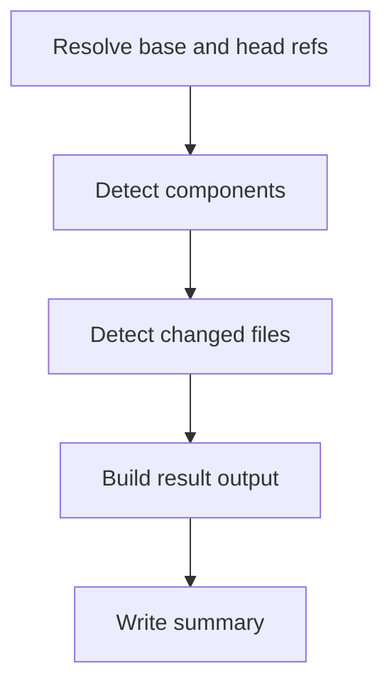
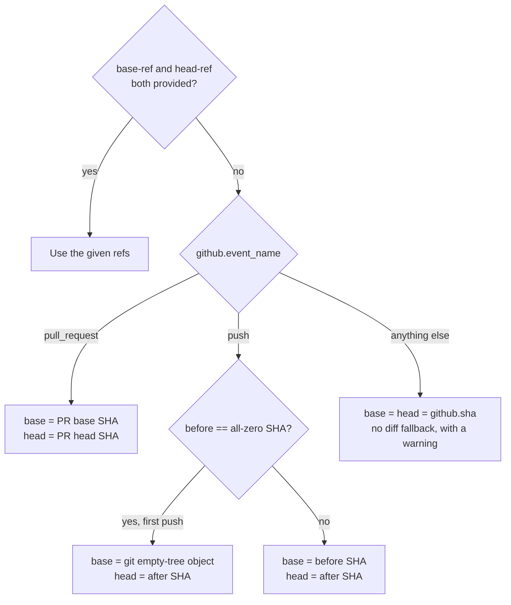

# `detect-changes`

Finds every component (a directory containing a recognized manifest, at any depth) in the repo, marks which changed in this PR/push, and derives repo-wide `project.*`/`changed.*` from that same component list. The foundation every other action in this platform is built on top of.

**Origin:** In-house (built for this platform, no third-party Action wrapped) — see [decisions.md](../../docs/decisions.md), row `detect-changes` implementation.

## Inputs

| Name | Required | Default | Description |
|---|---|---|---|
| `base-ref` | No | Derived from the triggering event | Commit SHA to compare from. For `pull_request`, the PR's base SHA; for `push`, the `before` SHA (or git's empty-tree object on a branch's first push). Set explicitly to call this action standalone, outside `pull_request`/`push`. |
| `head-ref` | No | Derived from the triggering event | Commit SHA to compare to. For `pull_request`, the PR's head SHA; for `push`, the `after` SHA. |

## Outputs

| Name | Description |
|---|---|
| `result` | JSON string: `{ "project": {...}, "changed": {...}, "components": [...] }`. `project.*`/`changed.*` are booleans per capability (`python`, `node`, `docker`, `terraform`, `markdown`), **derived from** `components`, not computed separately. `components` is `[{ "path": "...", "type": "...", "changed": true/false }]`, one entry per directory+capability found in the repo. |

## How it works



- **Resolve base and head refs** — bash, decides `BASE_REF`/`HEAD_REF` from inputs or the triggering event.
- **Detect components** — bash, one recursive `find` per capability across the whole repo (noise directories like `.git`/`node_modules`/`.venv` excluded), deduplicated per (directory, type). `project.*` is derived from this list.
- **Detect changed files** — `actions/github-script`, calls the GitHub compare API once with the resolved refs, then marks each component `changed: true/false` based on whether any changed file falls under it and matches that capability's signal patterns. `changed.*` is derived from this list.
- **Build result output** — bash, combines `project`/`changed`/`components` into the single `result` JSON.
- **Write summary** — bash, renders a human-readable table into the job summary.

### Ref resolution decision tree



## Usage

```yaml
- uses: ./actions/detect-changes
  id: detect
```

```yaml
# Standalone, outside a pull_request/push context
- uses: ./actions/detect-changes
  with:
    base-ref: abc123...
    head-ref: def456...
```

## Known issues / Limitations

- **Root component over-matches.** The root component (`path: "."`) matches every changed file, including ones that already belong to a more specific nested component of the same type — this can mark a root-level component as "changed" when the actual change was scoped to a nested component. Over-triggers, never under-triggers (see [roadmap.md](../../docs/roadmap.md), "Known limitations").
- **No include-relationship detection.** Every manifest found is treated as its own independent component; manifests that reference each other (e.g. a `requirements/dev.txt` that `-r`-includes `requirements/base.txt`) are not merged, so they can be audited redundantly rather than incorrectly.
- **GitHub compare API truncation.** The API caps the `files` list around ~300 changed files for very large diffs; a warning is logged when this happens, but `changed.*`/`components[].changed` may be incomplete for that diff.
- **Fixed noise-directory exclusion list.** `.git`, `.checks-toolkit` (the platform's own checkout that `ci.yml` places in the workspace root — without this its files showed up as components of the consumer repo), `node_modules`, `.venv`, `venv`, `__pycache__`, `.terraform`, `dist`, `build` are hardcoded in the action; not configurable per consumer repo.
- **HTML/web and other uncovered capabilities are invisible.** Only the five capabilities in the signal table (Python, Node, Docker, Terraform, Markdown) are recognized — anything else is silently ignored, not flagged as unknown.

## Related documentation

- [decisions.md](../../docs/decisions.md) — rows on `detect-changes` (base/head resolution, diff mechanism, signal matching, output shape)
- [workflows.md](../../docs/workflows.md) — the detection output schema and actions overview
