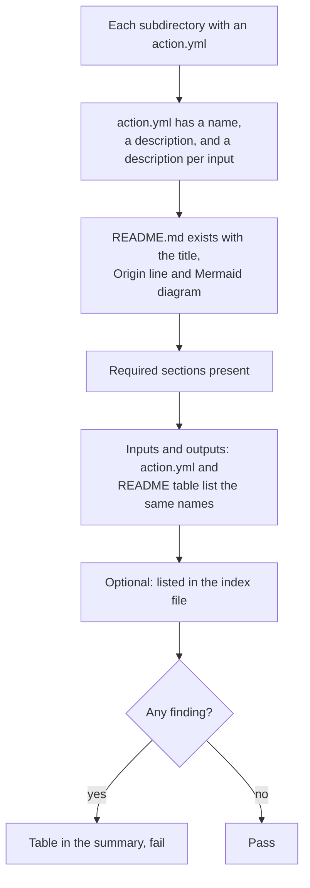

# `lint-action-docs`

Checks that every composite action in a directory has a README that matches its `action.yml`: the required sections and a Mermaid diagram are there, every input and output is documented, and nothing is documented that the action does not have. It keeps a platform of many small actions from drifting away from its own documentation. It reads files only and fails the step on any finding.

**Origin:** In-house composite action; a short Python script using PyYAML, no third-party Action.

## Inputs

| Name | Required | Default | Description |
|---|---|---|---|
| `actions-directory` | No | `actions` | Directory whose subdirectories are the actions to check. |
| `index-file` | No | `""` | Optional Markdown file that has to mention every action by name in backticks, for example `docs/workflows.md`. Empty skips the check. |
| `pyyaml-version` | No | `6.0.3` | Exact PyYAML version to install, pinned so a new release cannot change the result of an unchanged pull request. |

## Outputs

This action produces no outputs; it succeeds or fails, and writes the findings to the job summary.

## How it works



What it requires of a README follows [`actions/TEMPLATE.md`](../TEMPLATE.md): the title ``# `<action-name>` ``, an `**Origin:**` line, a Mermaid block, and the sections `Inputs`, `Outputs`, `How it works`, `Usage` and `Known issues / Limitations`. A directory without an `action.yml` is not treated as an action.

The README and `action.yml` come from the pull request, so they are only read as data by the script. Nothing in them is executed.

## Usage

```yaml
- uses: actions/checkout@3d3c42e5aac5ba805825da76410c181273ba90b1 # v7.0.1
  with:
    persist-credentials: false

- uses: ./actions/lint-action-docs
  with:
    index-file: docs/workflows.md
```

## Known issues / Limitations

- **It checks that the docs are complete, not that they are right.** A description that says the wrong thing passes; a missing or invented input does not.
- **Names are matched, not meaning.** An input is documented when it is the first column of a row in the `Inputs` table, in backticks.
- **The layout is this platform's own.** A repository with another README layout has to leave this action out or follow the template.
- **Installs PyYAML with pip,** pinned by version but not by hash, like `codespell`.
- **Verified locally** against this repository's actions, including a README with a missing and an invented input; run on a real pull request once `check-repo.yml` is merged.

## Related documentation

- [`actions/TEMPLATE.md`](../TEMPLATE.md) — the README layout this action checks
- [contributing.md](../../docs/contributing.md#per-action-readme) — the rule behind it
