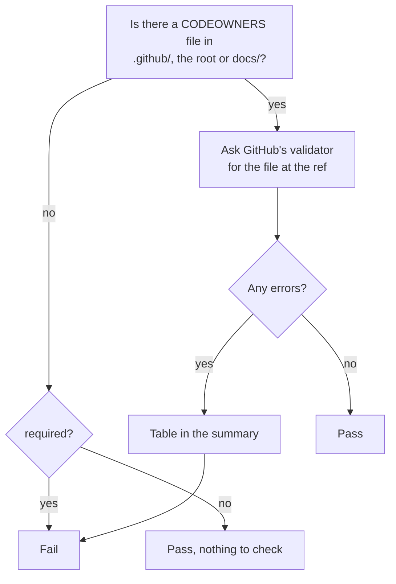

# `lint-codeowners`

Checks the `CODEOWNERS` file with GitHub's own validator: syntax errors, owners that do not exist, owners without write access, and patterns that are wrong. A broken `CODEOWNERS` fails silently (the review request is never made), so this is the check that notices. The step fails on any finding.

**Origin:** In-house composite action; the GitHub CLI (`gh`) that is preinstalled on GitHub-hosted runners, calling the [codeowners errors API](https://docs.github.com/rest/repos/repos#list-codeowners-errors). No third-party Action.

## Inputs

| Name | Required | Default | Description |
|---|---|---|---|
| `required` | No | `false` | Fail when the repository has no `CODEOWNERS` file (in `.github/`, the root or `docs/`). A repository does not have to have one. |
| `ref` | No | The commit of the triggering event | Commit, branch or tag whose `CODEOWNERS` file is validated. |
| `token` | No | `github.token` | Token for the GitHub API. Needs `contents: read`. |

## Outputs

This action produces no outputs; it succeeds or fails, and writes the findings to the job summary.

## How it works



The validator belongs to GitHub, so it knows which users and teams exist and have write access, which a check run on the files alone cannot.

## Usage

```yaml
permissions:
  contents: read

steps:
  - uses: actions/checkout@3d3c42e5aac5ba805825da76410c181273ba90b1 # v7.0.1
    with:
      persist-credentials: false

  - uses: ./actions/lint-codeowners
    with:
      required: true
```

## Known issues / Limitations

- **It validates the file on GitHub, at the ref,** not the working tree. A local edit that is not pushed is not seen. For a pull request the default ref is the merge commit, which exists on GitHub.
- **Private repositories and teams.** An owner that is a team needs the token to be able to see that team; a token that cannot may report a valid team as unknown.
- **Only the file's validity is checked,** not whether the right people own the right paths.
- **Verified locally** against this repository's `CODEOWNERS` (no errors), and a repository without one; run on a real pull request once `check-repo.yml` is merged.

## Related documentation

- [GitHub: about code owners](https://docs.github.com/repositories/managing-your-repositorys-settings-and-features/customizing-your-repository/about-code-owners)
- [contributing.md](../../docs/contributing.md#pull-requests-and-branch-rules) — how this repository uses it
