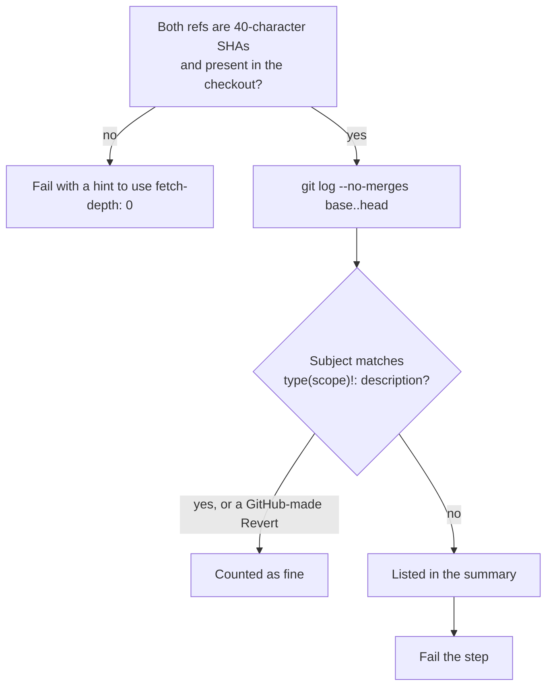

# `lint-commits`

Checks that every commit in a range has a [Conventional Commits](https://www.conventionalcommits.org) subject (`feat: ...`, `fix(scope): ...`, and so on). The release notes are generated from those subjects, so a commit without one would be missing from them. The step fails and lists the offending commits in the job summary.

**Origin:** In-house composite action; plain `git log` and a regular expression, no tool and no third-party Action.

## Inputs

| Name | Required | Default | Description |
|---|---|---|---|
| `base-ref` | Yes | — | Commit SHA the range starts after (exclusive); for a pull request, the base branch tip. |
| `head-ref` | Yes | — | Commit SHA the range ends at (inclusive); for a pull request, the head commit. |

## Outputs

This action produces no outputs; it succeeds or fails, and writes the offending commits to the job summary.

## How it works



Allowed types: `feat`, `fix`, `docs`, `style`, `refactor`, `perf`, `test`, `build`, `ci`, `chore`, `revert`. Merge commits are not checked.

Commit messages are written by whoever opened the pull request, so they are untrusted. They are only read into variables and printed indented, so a message cannot run a command or break out of the summary's formatting. Both were tested with a hostile message.

## Usage

The repository must be checked out with full history:

```yaml
- uses: actions/checkout@3d3c42e5aac5ba805825da76410c181273ba90b1 # v7.0.1
  with:
    fetch-depth: 0
    persist-credentials: false

- uses: ./actions/lint-commits
  with:
    base-ref: ${{ github.event.pull_request.base.sha }}
    head-ref: ${{ github.event.pull_request.head.sha }}
```

## Known issues / Limitations

- **Needs `fetch-depth: 0`.** In a shallow clone the commits of the range are missing; the action says so instead of passing.
- **Only the subject is checked**, not the body, and not that the description is sensible.
- **A pull request that is merged by squashing** gets one new commit whose subject is the pull request title, which this action does not see. This repository merges with merge commits, so each commit is checked.
- **Verified locally** with good, bad, merge, revert and hostile messages; run on a real pull request once `check-commits.yml` is merged.

## Related documentation

- [decisions.md](../../docs/decisions.md) — "Conventional Commits are enforced on pull requests"
- [contributing.md](../../docs/contributing.md#commit-messages) — the format
