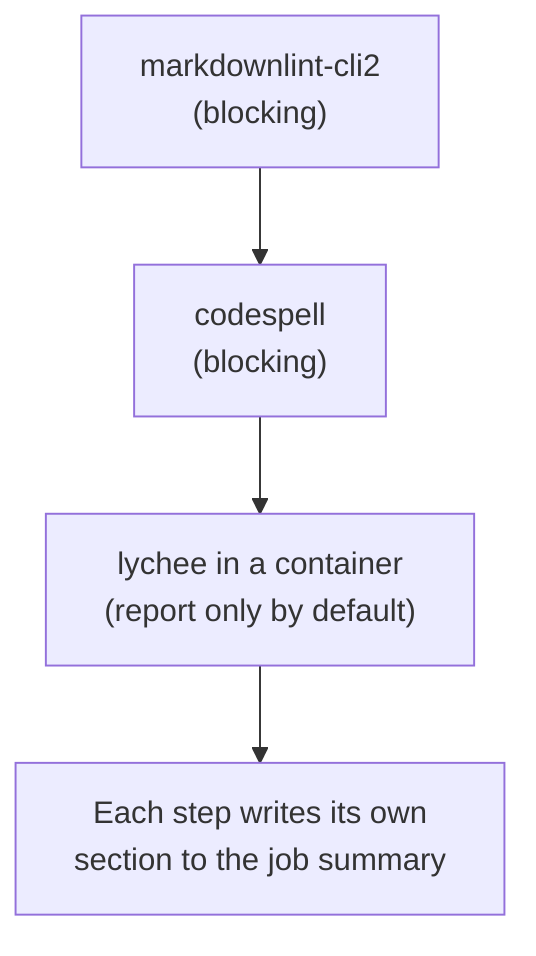

# `lint-markdown`

Checks the Markdown files of one component in three independent steps: structure and style ([markdownlint-cli2](https://github.com/DavidAnson/markdownlint-cli2)), spelling ([codespell](https://github.com/codespell-project/codespell)) and broken links ([lychee](https://github.com/lycheeverse/lychee)).

**Origin:** In-house composite action that calls the three CLIs directly (no wrapped GitHub Action) — allowed per the [Actions policy](../../docs/contributing.md#actions-policy). The lychee image and the Python/npm packages are a different supply chain than Actions; see [decisions.md](../../docs/decisions.md), row "`lint-markdown` tooling".

## Inputs

| Name | Required | Default | Description |
|---|---|---|---|
| `working-directory` | No | `.` | Directory whose `*.md` files are checked — one component's `path` from `detect-changes`' `components[]`. Not recursive: a nested directory is its own component. |
| `fail-on-broken-links` | No | `false` | Fail the link step when lychee finds broken links. Off by default because link checks depend on third-party sites. `ci.yml` wires this to its `fail-on-findings` input. |

## Outputs

| Name | Description |
|---|---|
| `broken-link-count` | Number of broken links lychee found (errors and timeouts), `0` if none |

## How it works



The steps run independently (`if: !cancelled()`), so one failing check does not hide the findings of the others.

### Configuration

| Tool | Platform default | How a repo overrides it |
|---|---|---|
| markdownlint | [`markdownlint.jsonc`](./markdownlint.jsonc) as base config (line length and table style off) | Commit a `.markdownlint-cli2.jsonc` or `.markdownlint.jsonc` next to the files or in a parent directory; the nearest one wins. `ignores` in `.markdownlint-cli2.jsonc` only applies to the directory the file sits in. |
| codespell | `--builtin clear` (unambiguous misspellings only) | Commit a `.codespellrc` in the component directory (`skip`, `ignore-words-list`). Paths in `skip` are written `./name.md`. |
| lychee | Fixed flags, see the action | Not configurable yet. |

## Usage

```yaml
- uses: ./actions/lint-markdown
```

```yaml
# Against one component, failing on broken links
- uses: ./actions/lint-markdown
  with:
    working-directory: docs
    fail-on-broken-links: "true"
```

## Known issues / Limitations

- **English only.** codespell flags common Dutch words that happen to be English typos. Markdown in another language needs a `.codespellrc` that skips it.
- **Link checking is anonymous and online.** GitHub and other sites rate-limit or block anonymous requests (a 403 on a valid link is common), which is why it only reports by default. 429 counts as OK. Private, loopback and link-local addresses are excluded on purpose (SSRF protection).
- **Anchors (`#section`) are not checked**, only that the target file or URL exists.
- **The Docker image is pinned by digest, the npm and pip packages by version only.** Their transitive dependencies are not locked.

## Related documentation

- [decisions.md](../../docs/decisions.md) — "`lint-markdown` tooling"
- [workflows.md](../../docs/workflows.md) — actions overview and capability → CI mapping
