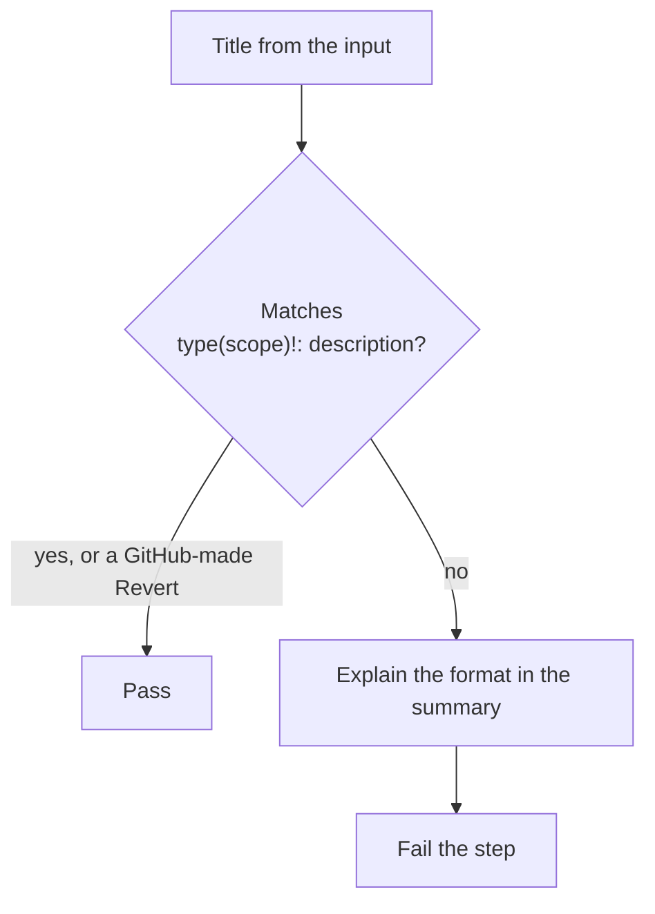

# `lint-pr-title`

Checks that a pull request title is a [Conventional Commits](https://www.conventionalcommits.org) subject (`feat: ...`, `fix(scope): ...`, and so on). When a pull request is merged by squashing, the title becomes the commit subject, and the release notes are generated from commit subjects. The step fails and explains the expected format in the job summary.

**Origin:** In-house composite action; a regular expression in Bash, no tool and no third-party Action.

## Inputs

| Name | Required | Default | Description |
|---|---|---|---|
| `title` | Yes | — | The pull request title to check, normally `github.event.pull_request.title`. |

## Outputs

This action produces no outputs; it succeeds or fails, and explains a failure in the job summary.

## How it works



Allowed types: `feat`, `fix`, `docs`, `style`, `refactor`, `perf`, `test`, `build`, `ci`, `chore`, `revert`. The pattern is the same one `lint-commits` uses, so a title and a commit follow the same rule.

A title is written by whoever opened the pull request, so it is untrusted. It is only read into an environment variable and printed indented, so a title cannot run a command or break out of the summary's formatting. A title containing `$(...)` was tested and is treated as text.

## Usage

A title can be edited without any push, so the workflow has to run on `edited` as well:

```yaml
on:
  pull_request:
    types: [opened, edited, reopened, synchronize]

jobs:
  lint-pr-title:
    runs-on: ubuntu-latest
    steps:
      - uses: actions/checkout@3d3c42e5aac5ba805825da76410c181273ba90b1 # v7.0.1
        with:
          persist-credentials: false

      - uses: ./actions/lint-pr-title
        with:
          title: ${{ github.event.pull_request.title }}
```

## Known issues / Limitations

- **Only the format is checked,** not that the description is sensible, and not that the type matches the change.
- **It only matters with squash merging.** This repository merges with merge commits, so the commits themselves are what the release notes use (checked by `lint-commits`). The title check keeps titles tidy and is what protects the notes if squash merging is ever used.
- **The `edited` trigger is what keeps the check current.** Without it, fixing a title would not start a new run, and a required check would stay red.
- **Tested locally** with good, bad and hostile titles and linted with `actionlint`; run on a real pull request once `check-pr-title.yml` is merged.

## Related documentation

- [decisions.md](../../docs/decisions.md) — "Conventional Commits are enforced on pull requests"
- [contributing.md](../../docs/contributing.md#commit-messages) — the format
