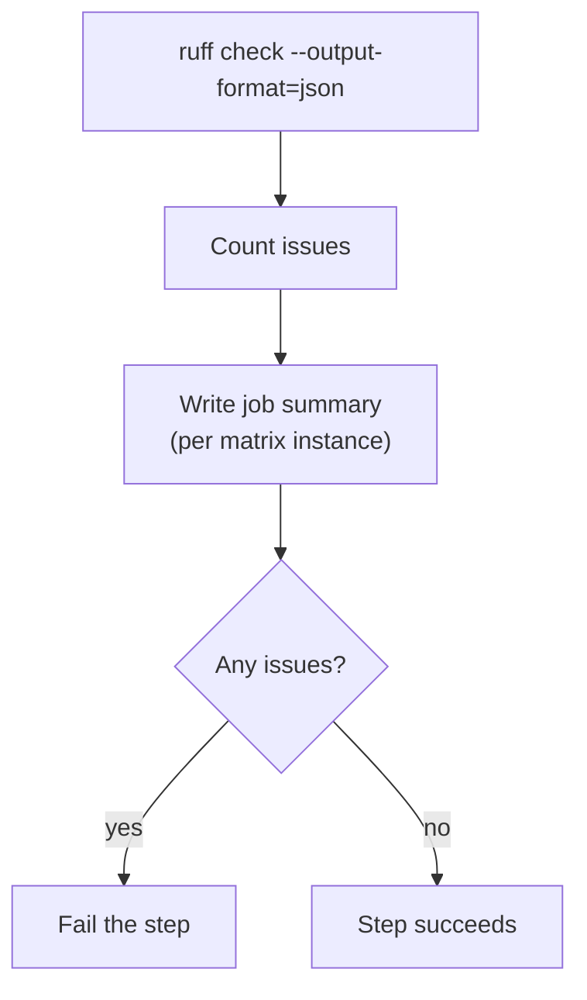

# `lint-python`

Lints Python code with [Ruff](https://docs.astral.sh/ruff/). A blocking check: the step fails when Ruff finds an issue, with no "report only" mode — see [decisions.md](../../docs/decisions.md), row "`ci.yml` matrix failure model".

**Origin:** In-house composite action that installs and calls the Ruff CLI directly (not a wrapped GitHub Action) — allowed per the [Actions policy](../../docs/contributing.md#actions-policy) (official ecosystem tool). See [workflows.md](../../docs/workflows.md#actions-overview).

## Inputs

| Name | Required | Default | Description |
|---|---|---|---|
| `working-directory` | No | `.` | Directory to run Ruff in — one component's `path` from `detect-changes`' `components[]` when linting a specific spot in a monorepo. |

## Outputs

This action produces no outputs; it succeeds or fails, and writes its findings to the job summary.

## How it works



## Usage

```yaml
- uses: ./actions/lint-python
```

```yaml
# Against one component in a monorepo (path from detect-changes' components[])
- uses: ./actions/lint-python
  with:
    working-directory: backend
```

## Known issues / Limitations

- **No per-component exception.** A component with legacy code that doesn't pass Ruff yet has no way to opt out — see the "Known limitations" entry in [roadmap.md](../../docs/roadmap.md) on per-component failure-policy overrides.
- **No Ruff config committed yet.** Runs with Ruff's own defaults until this platform (or the consumer repo) ships a `ruff.toml`/`pyproject.toml` `[tool.ruff]` section.

## Related documentation

- [decisions.md](../../docs/decisions.md) — "`ci.yml` matrix failure model"
- [workflows.md](../../docs/workflows.md) — actions overview and capability → CI mapping
