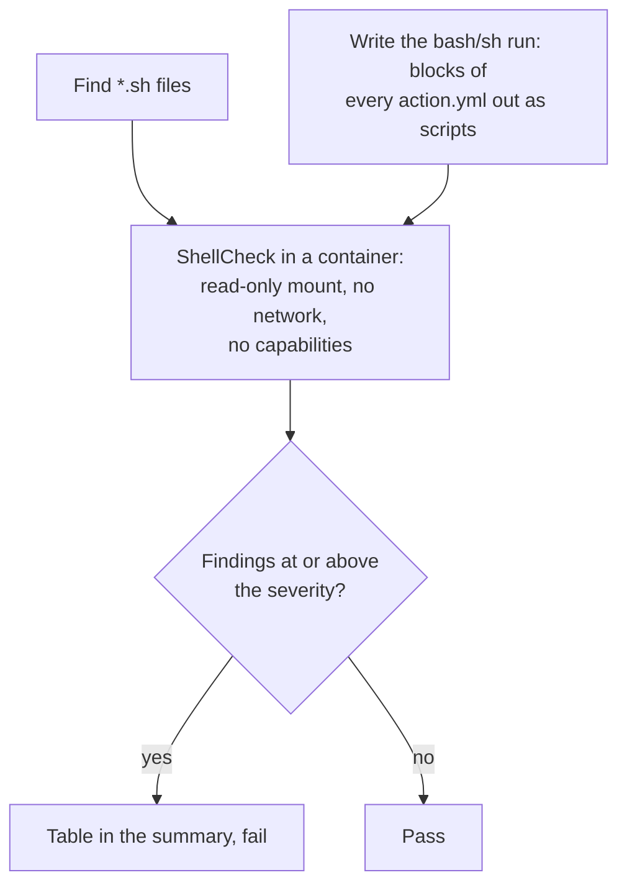

# `lint-shell`

Checks shell scripts with [ShellCheck](https://www.shellcheck.net): every `*.sh` file, and the `bash`/`sh` `run:` blocks of composite actions (`action.yml`). Most of the logic of a platform made of composite actions is Bash inside YAML, which `actionlint` does not look at (it only checks workflows), so this closes that gap. It reads the files only and fails the step on any finding at or above the chosen severity.

**Origin:** In-house composite action; wraps the official [`koalaman/shellcheck`](https://hub.docker.com/r/koalaman/shellcheck) container image, pinned by version and digest, and runs it directly with `docker run`. No third-party Action.

## Inputs

| Name | Required | Default | Description |
|---|---|---|---|
| `working-directory` | No | `.` | Directory to check, recursively. |
| `severity` | No | `warning` | Lowest ShellCheck severity that is reported and fails the step: `error`, `warning`, `info` or `style`. |
| `pyyaml-version` | No | `6.0.3` | Exact PyYAML version to install (used to read the `action.yml` files), pinned so a new release cannot change the result of an unchanged pull request. |

## Outputs

This action produces no outputs; it succeeds or fails, and writes the findings to the job summary.

## How it works



An expression such as `${{ inputs.x }}` inside a `run:` block is replaced by a placeholder before the block is checked, the same way `actionlint` does it, so the rest of the script still parses. Steps with another shell (`pwsh`, `python`) are skipped. The summary names the `action.yml` and the step for a finding in a `run:` block.

Workflow `run:` blocks are not checked here: `lint-workflows` already runs ShellCheck on them through `actionlint`.

The scripts come from the pull request and are untrusted. They are only read: ShellCheck parses them in a container with no network and no capabilities, and the Python that extracts the blocks only parses YAML and writes text.

## Usage

```yaml
- uses: actions/checkout@3d3c42e5aac5ba805825da76410c181273ba90b1 # v7.0.1
  with:
    persist-credentials: false

- uses: ./actions/lint-shell
```

```yaml
# Stricter, and only one folder
- uses: ./actions/lint-shell
  with:
    working-directory: scripts
    severity: info
```

## Known issues / Limitations

- **The line number is the line within the script.** For an action step that is the line within its `run:` block, not within `action.yml`.
- **A placeholder stands in for expressions.** A script that depends on what an expression expands to, for example an unquoted `${{ inputs.x }}`, is checked as if it were a single word.
- **Only `*.sh` files and composite actions.** Scripts without a `.sh` extension are not found, even with a shebang.
- **`source`d files are not followed,** so a script that depends on a sourced file may report variables as unassigned.
- **Installs PyYAML with pip,** pinned by version but not by hash, like `codespell`.
- **Verified locally,** with a `.sh` file and an action step that both have findings, and against this repository (no findings at `warning`); run on a real pull request once `check-repo.yml` is merged.

## Related documentation

- [decisions.md](../../docs/decisions.md) — "Actions pinned to commit SHAs" and "Security tools run as pinned container images"
- [lint-workflows](../lint-workflows/README.md) — the same kind of check for workflow files
