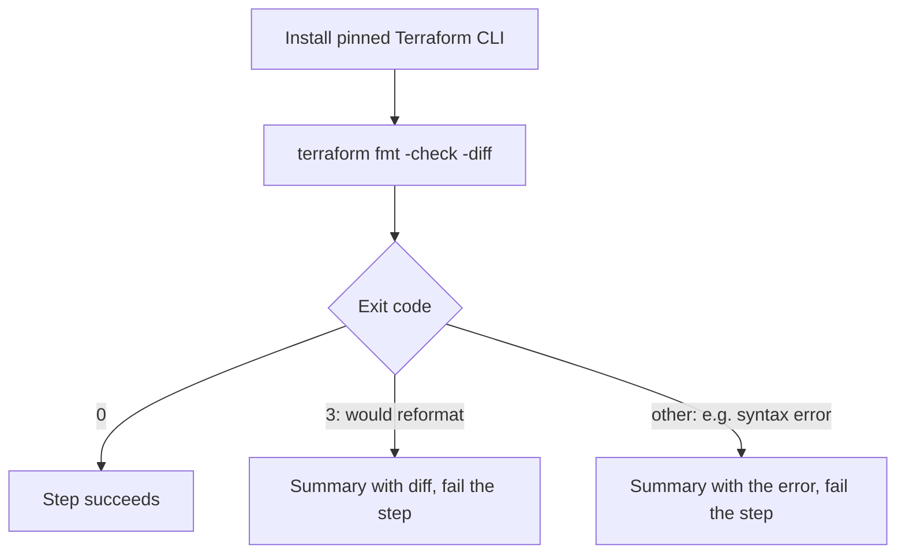

# `lint-terraform`

Checks the Terraform files of one component with `terraform fmt -check`. `terraform validate` is planned as the next step and is not implemented yet.

**Origin:** In-house composite action. It uses the official [`hashicorp/setup-terraform`](https://github.com/hashicorp/setup-terraform) Action, published by HashiCorp, only to install the CLI — allowed per the [Actions policy](../../docs/contributing.md#actions-policy) (official/verified publisher). See [decisions.md](../../docs/decisions.md), row "`lint-terraform` in steps".

## Inputs

| Name | Required | Default | Description |
|---|---|---|---|
| `working-directory` | No | `.` | Directory whose `*.tf` files are checked — one component's `path` from `detect-changes`' `components[]`. Not recursive: a nested directory is its own component. |
| `terraform-version` | No | `1.16.5` | Exact Terraform CLI version to install. Pinned instead of `latest` so a new release cannot change the result of an unchanged PR. |

## Outputs

This action produces no outputs; it succeeds or fails, and writes its findings to the job summary.

## How it works



`fmt` only parses the files. It runs no `init`, downloads no providers or modules, makes no network calls and needs no credentials or state.

## Usage

```yaml
- uses: ./actions/lint-terraform
```

```yaml
# Against one component in a monorepo
- uses: ./actions/lint-terraform
  with:
    working-directory: infra/network
```

## Known issues / Limitations

- **Only formatting is checked so far.** A syntactically valid `.tf` file with wrong references or types passes. `terraform validate` closes that gap but needs `terraform init -backend=false` and therefore provider downloads — see the supply-chain notes in [decisions.md](../../docs/decisions.md) once that step is built.
- **No per-component exception.** Same limitation as `lint-python`.

## Related documentation

- [decisions.md](../../docs/decisions.md) — "`lint-terraform` in steps"
- [workflows.md](../../docs/workflows.md) — actions overview and capability → CI mapping
