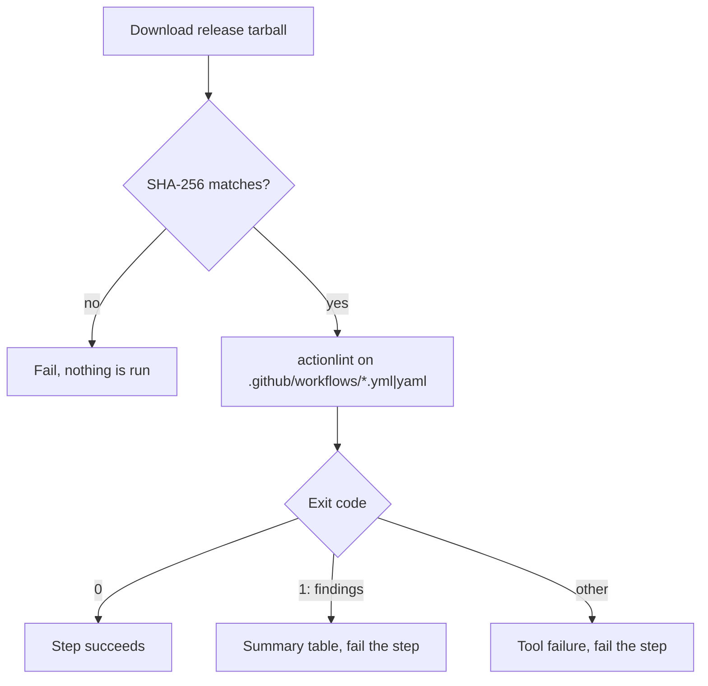

# `lint-workflows`

Checks the GitHub Actions workflow files in `.github/workflows` with [actionlint](https://github.com/rhysd/actionlint): syntax, `${{ }}` expression types, `needs`/`matrix`/`inputs` references, and the shell in `run:` blocks. It answers "is this workflow *correct*?"; the security side is [`scan-workflows`](../scan-workflows/README.md).

**Origin:** In-house composite action. actionlint (by rhysd) is not an official or verified publisher under the [Actions policy](../../docs/contributing.md#actions-policy), so no Action wrapper is used: the release tarball is downloaded and its SHA-256 is verified before anything runs. See [decisions.md](../../docs/decisions.md), rows "Workflow checks" and "Workflow checkers: supply chain".

## Inputs

| Name | Required | Default | Description |
|---|---|---|---|
| `actionlint-version` | No | `1.7.12` | Exact actionlint version (no leading `v`). Pinned instead of `latest` so a new release cannot change the result of an unchanged PR. |
| `actionlint-sha256` | No | see `action.yml` | SHA-256 of the `linux_amd64` tarball for that version. **Change it together with the version**; the download is rejected on a mismatch. |

## Outputs

This action produces no outputs; it succeeds or fails, and writes its findings to the job summary.

## How it works



Files are passed explicitly (only `*.yml` and `*.yaml` directly in `.github/workflows`), so the platform checkout that `ci.yml` places in `.checks-toolkit/` is never linted. When `shellcheck` is on the `PATH` (preinstalled on GitHub-hosted Ubuntu runners) actionlint also checks the `run:` scripts.

## Usage

```yaml
- uses: ./actions/lint-workflows
```

## Known issues / Limitations

- **Workflows only.** Composite `action.yml` files are not checked by actionlint; [`scan-workflows`](../scan-workflows/README.md) covers them for security.
- **Linux amd64 only.** The installer downloads the `linux_amd64` build. Other architectures (for example an arm64 self-hosted runner) need another hash and archive name.
- **Hash upkeep is manual.** Dependabot does not know about the pinned hash; it is listed in the [pinned versions table](../../docs/contributing.md#pinned-versions).
- **Without `shellcheck`** the `run:` scripts are not checked, silently.

## Related documentation

- [decisions.md](../../docs/decisions.md) — "Workflow checks", "Workflow checkers: supply chain"
- [workflows.md](../../docs/workflows.md) — actions overview and `check-workflows.yml`
