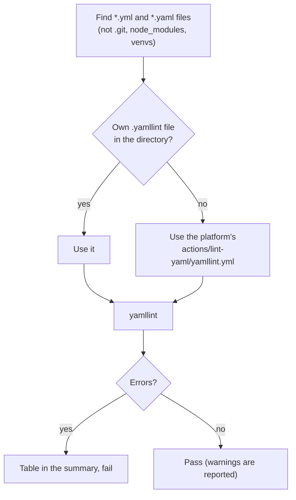

# `lint-yaml`

Checks the syntax and style of YAML files (`*.yml`, `*.yaml`) with [yamllint](https://yamllint.readthedocs.io): invalid YAML, duplicate keys, inconsistent indentation, trailing spaces and similar. A repository made of workflows, action definitions and configuration is mostly YAML, and an error there often only shows when the file is used. The step fails on an error; warnings are reported.

**Origin:** In-house composite action; `pip install` of yamllint at a pinned version and a plain call, no third-party Action.

## Inputs

| Name | Required | Default | Description |
|---|---|---|---|
| `working-directory` | No | `.` | Directory to check, recursively. |
| `fail-on-warnings` | No | `false` | Also fail the step on warnings. By default errors fail and warnings are only reported. |
| `yamllint-version` | No | `1.37.1` | Exact yamllint version to install, pinned so a new release cannot change the result of an unchanged pull request. |

## Outputs

This action produces no outputs; it succeeds or fails, and writes the findings to the job summary.

## How it works



The platform rules start from yamllint's `default` set and relax what does not suit workflows: line length is off, a document start (`---`) is not required, `on:` is not read as a boolean key, and the indentation only has to be consistent. A repository that wants other rules commits its own `.yamllint` (or `.yamllint.yml` or `.yamllint.yaml`) in the checked directory, which replaces the platform's file.

The YAML comes from the pull request. yamllint only parses it, and file names are passed as arguments, never through the shell, so a hostile name or content is data.

## Usage

```yaml
- uses: actions/checkout@3d3c42e5aac5ba805825da76410c181273ba90b1 # v7.0.1
  with:
    persist-credentials: false

- uses: ./actions/lint-yaml
```

```yaml
# Only one folder, and warnings fail too
- uses: ./actions/lint-yaml
  with:
    working-directory: deploy
    fail-on-warnings: true
```

## Known issues / Limitations

- **Style, not meaning.** It does not know whether a workflow or a Kubernetes manifest is valid; that is `lint-workflows` for workflows and, for Terraform and other formats, their own checks.
- **No `.gitignore` support.** Generated YAML in the directory is checked too; leave it out with a `.yamllint` that sets `ignore`.
- **A broken config or an unreadable file is a tool error,** and fails the step; it is not read as "no findings".
- **Installs yamllint with pip,** pinned by version but not by hash, like `codespell`.
- **Verified locally** against this repository (no findings) and a file with duplicate keys, bad spacing and trailing spaces; run on a real pull request once `check-repo.yml` is merged.

## Related documentation

- [lint-workflows](../lint-workflows/README.md) — checks that workflows are valid, not only well-formed
- [contributing.md](../../docs/contributing.md) — the conventions this repository's own YAML follows
