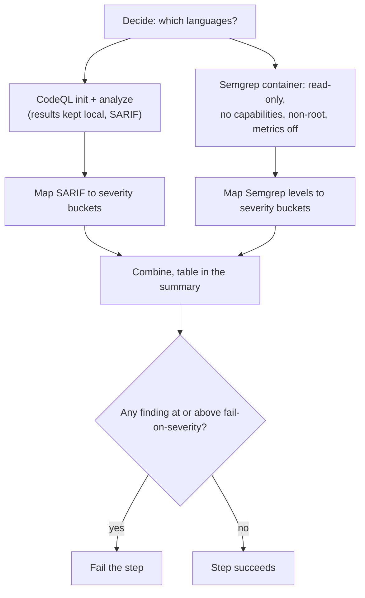

# `scan-code`

Static analysis (SAST) of the whole repository in one run: [Semgrep](https://semgrep.dev/) for Python, JavaScript/TypeScript and Dockerfiles, and [CodeQL](https://codeql.github.com/) for Python and JavaScript/TypeScript when it is switched on with `codeql`. The step fails when a finding at or above `fail-on-severity` exists; every finding is listed in the job summary.

**Origin:** In-house composite action. CodeQL uses GitHub's own [`github/codeql-action`](https://github.com/github/codeql-action) (`init` and `analyze`, pinned to a commit — CodeQL only exists in that form). Semgrep runs as the official container image, pinned by version **and** digest. See [decisions.md](../../docs/decisions.md), rows "CodeQL/Semgrep bundling" and "Dockerfile linting lives in `scan-code` (Semgrep)".

## Inputs

| Name | Required | Default | Description |
|---|---|---|---|
| `codeql` | No | `false` | Also run CodeQL. **Off by default and has to be switched on:** CodeQL only works on a public repository or one with GitHub Advanced Security, and on any other private repository it fails, which would fail this whole step. When it is off, the summary says so and Semgrep still runs. |
| `python` | No | `false` | Python is present (`detect-changes` `project.python`): Semgrep `p/python`, plus CodeQL Python when `codeql` is on. |
| `node` | No | `false` | Node/TypeScript is present (`project.node`): CodeQL JavaScript/TypeScript + Semgrep `p/javascript` and `p/typescript`. |
| `docker` | No | `false` | Dockerfiles are present (`project.docker`): Semgrep `p/dockerfile`. CodeQL has no Dockerfile support. |
| `fail-on-severity` | No | `high` | Lowest severity that fails the step: `critical`, `high`, `medium`, `low`, or `none` (report only). |
| `upload-sarif` | No | `false` | Also upload CodeQL's results to GitHub code scanning (Security tab). Needs `security-events: write` on the calling job, which a fork pull request never has, and GitHub Advanced Security on a private repository. |

## Outputs

| Name | Description |
|---|---|
| `result` | Counts per severity, both tools combined, as JSON: `{low, medium, high, critical, total}`. |

## How it works



Severity mapping: CodeQL's `security-severity` score gives 9+ critical, 7+ high, 4+ medium, below that low (rules without a score use the SARIF level). Semgrep has no critical: ERROR counts as high, WARNING as medium, INFO as low.

The platform's own checkout (`.checks-toolkit`) is excluded from both tools.

## Usage

```yaml
- uses: ./actions/scan-code
  with:
    python: "true"
    node: "false"
    docker: "true"
```

## Known issues / Limitations

- **CodeQL is off by default and has not been run at all yet.** Its bundle is large and the action needs GitHub's runtime, so it cannot be tried locally. Only the SARIF-to-severity mapping was tested, against a hand-made SARIF file. The first real run on GitHub is the actual test.
- **CodeQL needs a public repository, or GitHub Advanced Security on a private one.** That is why `codeql` defaults to `false`: with it on in a private repository without Advanced Security, the CodeQL step fails.
- **Needs the network**: CodeQL downloads its bundle, Semgrep fetches its public rule sets (no account, no tokens, metrics off).
- **Results can change without a code change**, because Semgrep's registry rules are updated.
- **Semgrep was verified locally** against a sample project (Python and a Dockerfile), including the exclusion of `.checks-toolkit`.

## Related documentation

- [decisions.md](../../docs/decisions.md) — "Severity policy in the security actions"
- [security.md](../../docs/security.md#how-the-scans-run) — how scanners are isolated
