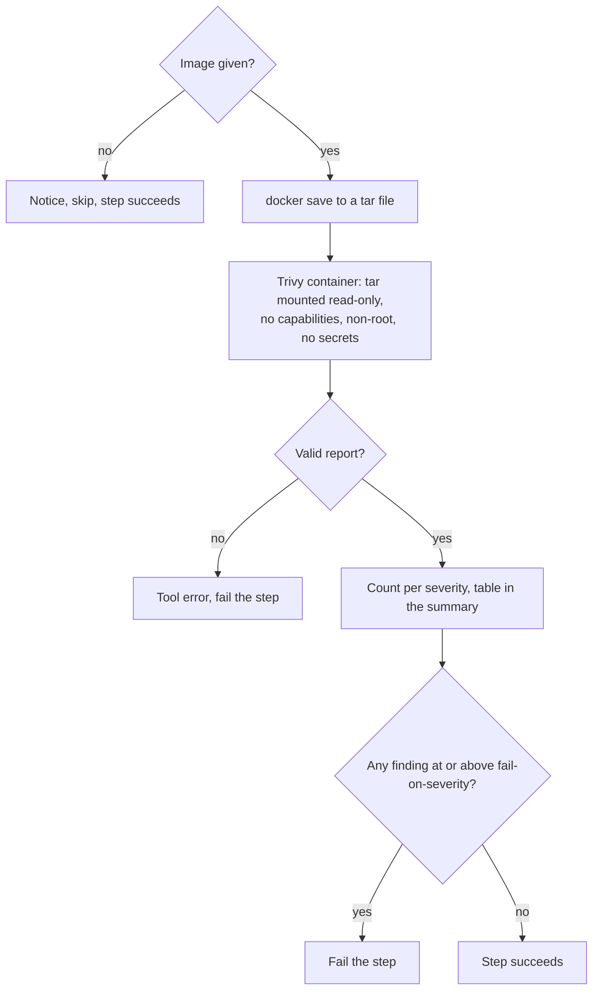

# `scan-docker`

Scans a built Docker image for known vulnerabilities — OS packages and language dependencies inside the image — with [Trivy](https://trivy.dev/). The step fails when a finding at or above `fail-on-severity` exists; every finding is listed in the job summary.

**Origin:** In-house composite action that runs the official Trivy container image (`ghcr.io/aquasecurity/trivy`), pinned by version **and** digest. It is deliberately not the `trivy-action` wrapper: one less piece of third-party action code in the supply chain, and the container can be locked down. See [decisions.md](../../docs/decisions.md), row "Security tools run as pinned container images, not third-party Actions".

## Inputs

| Name | Required | Default | Description |
|---|---|---|---|
| `image` | Yes | — | Local image tag to scan, the `image` output of `build-docker`. Empty means "nothing to scan": the action skips. |
| `fail-on-severity` | No | `high` | Lowest severity that fails the step: `critical`, `high`, `medium`, `low`, or `none` (report only). |
| `ignore-unfixed` | No | `true` | Ignore vulnerabilities that have no fixed version yet — nobody can fix those by updating, so they should not block a pull request. |

## Outputs

| Name | Description |
|---|---|
| `result` | Counts per severity as JSON: `{unknown, low, medium, high, critical, total}`. |

## How it works



The image reaches Trivy as a tar file, not through the Docker socket: access to the socket is root on the runner, and Trivy parses untrusted image contents.

## Usage

```yaml
- uses: ./actions/scan-docker
  with:
    image: ${{ steps.build.outputs.image }}
    fail-on-severity: critical
```

## Known issues / Limitations

- **Needs the network** for Trivy's vulnerability database. The default registry rate-limits anonymous pulls, so the official mirror is configured as a fallback.
- **Vulnerabilities only.** Secrets inside the image and Dockerfile misconfigurations are not scanned here (Dockerfile rules run in `scan-code`).
- **Results change over time** as the database is updated, so the same image can pass today and fail tomorrow. That is the point of scanning, but it means an unchanged pull request can turn red.
- **Verified locally** against a deliberately old image, an empty image and the report-only mode; not yet run on a GitHub runner.

## Related documentation

- [decisions.md](../../docs/decisions.md) — "Severity policy in the security actions"
- [security.md](../../docs/security.md#how-the-scans-run) — how scanners are isolated
