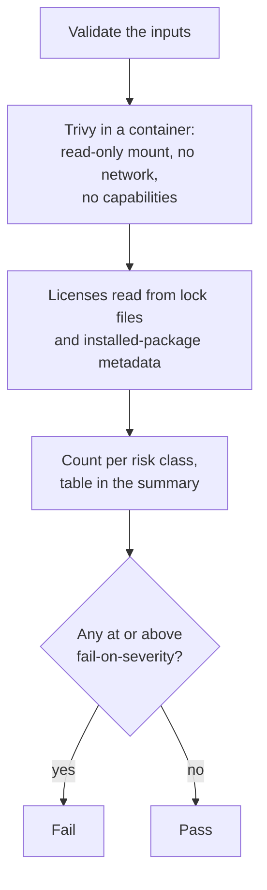

# `scan-licenses`

Checks the licenses of a project's dependencies with [Trivy](https://trivy.dev) and classes them by risk: a forbidden license (for example AGPL) is `critical`, a restricted one (GPL) `high`, a reciprocal one (MPL, LGPL) `medium`, and a notice or permissive one (MIT, Apache-2.0) `low`. The step fails when a license at or above `fail-on-severity` is found. It reads files only: nothing is installed, and the container has no network.

**Origin:** In-house composite action; calls the official [Trivy](https://github.com/aquasecurity/trivy) container image directly with `docker run`, pinned by version and digest (the same image as `scan-docker` and `scan-terraform`). No third-party Action.

## Inputs

| Name | Required | Default | Description |
|---|---|---|---|
| `working-directory` | No | `.` | Directory to scan, recursively. One component's path from `detect-changes` in a monorepo. |
| `fail-on-severity` | No | `high` | Lowest license risk that fails the step: `critical`, `high`, `medium`, `low`, or `none` (never fail, report only). |
| `ignored-licenses` | No | `""` | Comma-separated SPDX license names to leave out, for example for a dependency covered by a separate agreement. |

## Outputs

| Name | Description |
|---|---|
| `result` | License counts per severity as JSON: `{unknown, low, medium, high, critical, total}`. |

## How it works



The licenses come from files the pull request controls, so the container gets no network and no credentials, and Trivy only reads: it never installs a package or runs a build.

## Usage

```yaml
- uses: actions/checkout@3d3c42e5aac5ba805825da76410c181273ba90b1 # v7.0.1
  with:
    persist-credentials: false

- uses: ./actions/scan-licenses
```

```yaml
# Report only, and skip one license
- uses: ./actions/scan-licenses
  with:
    fail-on-severity: none
    ignored-licenses: LGPL-2.1-or-later
```

## Known issues / Limitations

- **Only licenses that are in the files can be found.** Trivy reads them from lock files that record a license (for example `package-lock.json`) and from installed packages (a `node_modules` or a virtualenv that is present). A lock file without license data, such as many Python lock files, gives no result unless the packages are installed. A clean result therefore means "no bad license found", not "every dependency was checked".
- **The classification is Trivy's.** What counts as restricted or reciprocal follows Trivy's default categories, which is not legal advice; a company policy needs its own list.
- **Dual-licensed packages** (`MIT OR GPL-3.0`) are reported with each license; which one applies is a decision for the user, and `ignored-licenses` is the way to record it.
- **Not part of `security.yml`.** It is a standalone action; this repository does not use it on itself, because it has no dependencies to scan. Offering it to consumers is a later step.
- **Verified locally** with a lock file that has a GPL and an MIT dependency (the GPL one blocks at `high`, and `ignored-licenses` lifts it) and with this repository (nothing found).

## Related documentation

- [audit-dependencies](../audit-dependencies/README.md) — known vulnerabilities in the dependencies a pull request adds
- [scan-docker](../scan-docker/README.md) — the same Trivy image, scanning container images
