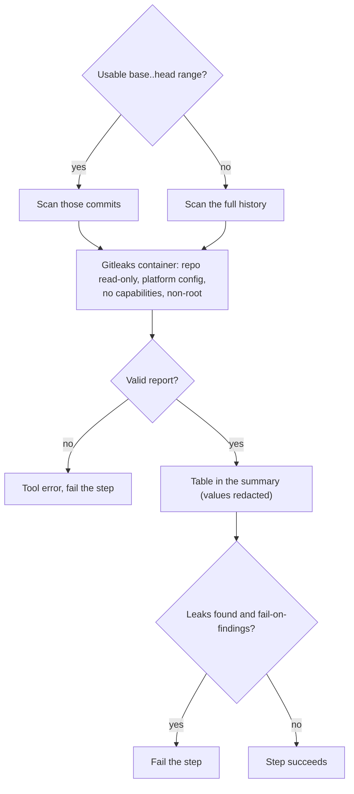

# `scan-secrets`

Scans git history for leaked secrets (API keys, tokens, private keys) with [Gitleaks](https://gitleaks.io/). With `base-ref` and `head-ref` it scans exactly the commits of a pull request or push — including a secret that was added and removed again within it; without them it scans the whole history. The step fails when anything is found. Secret values are redacted in every output.

**Origin:** In-house composite action that runs the official Gitleaks container image, pinned by version **and** digest. It is deliberately not `gitleaks-action`, which needs a paid license key for organization-owned repositories. See [decisions.md](../../docs/decisions.md), rows "`scan-secrets` tool choice" and "Security tools run as pinned container images, not third-party Actions".

## Inputs

| Name | Required | Default | Description |
|---|---|---|---|
| `base-ref` | No | empty | Commit to scan from (exclusive). With `head-ref`, limits the scan to `base-ref..head-ref`. |
| `head-ref` | No | empty | Commit to scan up to (inclusive). |
| `fail-on-findings` | No | `true` | Fail the step when a secret is found. Gitleaks has no severity, and a leaked secret is the one finding that must always block. |

Without a usable range the whole history is scanned: no refs given, an all-zero base (new branch), a base that is not a commit, or base equal to head (a manual run has no diff). A scan that silently checked nothing would be worse than one that checks too much.

## Outputs

| Name | Description |
|---|---|
| `finding-count` | Number of leaks found. |

## How it works



**The scanned repository cannot configure its scanner.** The action always passes the platform's own `gitleaks.toml` (Gitleaks' built-in rules) and points Gitleaks at a non-existent ignore file. A `.gitleaks.toml` or `.gitleaksignore` in the pull request is ignored, otherwise a pull request could allow-list its own secret in the same change.

## Usage

The repository must be checked out with the full history:

```yaml
- uses: actions/checkout@3d3c42e5aac5ba805825da76410c181273ba90b1 # v7.0.1
  with:
    fetch-depth: 0
    persist-credentials: false

- uses: ./actions/scan-secrets
  with:
    base-ref: ${{ github.event.pull_request.base.sha }}
    head-ref: ${{ github.event.pull_request.head.sha }}
```

## Known issues / Limitations

- **Needs `fetch-depth: 0`.** In a shallow clone the commit range does not exist and Gitleaks fails (reported as a tool error, not a pass).
- **A repository cannot silence its own false positives.** Because its config is deliberately ignored, a false positive needs a platform-side change. A per-repository allowlist would have to be read from the base branch, not from the pull request — not built.
- **A found secret is compromised.** Removing it in a later commit does not remove it from history: revoke and rotate it.
- **Verified locally** with a secret added and removed in a later commit, a clean range, report-only mode, the fallbacks to full history, and a pull request that tries to allow-list its own secret (still caught); not yet run on a GitHub runner.

## Related documentation

- [decisions.md](../../docs/decisions.md) — "Gitleaks ignores the scanned repository's own config"
- [security.md](../../docs/security.md#how-the-scans-run) — how scanners are isolated
