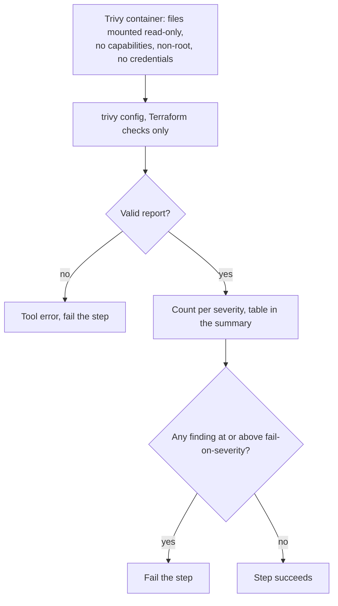

# `scan-terraform`

Scans Terraform files for security misconfigurations (for example a security group open to the whole internet) with [Trivy](https://trivy.dev/)'s `config` mode. The step fails when a finding at or above `fail-on-severity` exists; every finding is listed in the job summary.

**Origin:** In-house composite action that runs the official Trivy container image, pinned by version **and** digest (the same image as `scan-docker`). See [decisions.md](../../docs/decisions.md), rows "Terraform misconfiguration scanning" and "Security tools run as pinned container images, not third-party Actions".

## Inputs

| Name | Required | Default | Description |
|---|---|---|---|
| `working-directory` | No | `.` | Directory to scan — one component's `path` from `detect-changes`' `components[]`. |
| `fail-on-severity` | No | `high` | Lowest severity that fails the step: `critical`, `high`, `medium`, `low`, or `none` (report only). |

## Outputs

| Name | Description |
|---|---|
| `result` | Counts per severity as JSON: `{unknown, low, medium, high, critical, total}`. |

## How it works



Trivy only reads the files. It never runs Terraform: no `init`, no providers, no state, no cloud credentials.

## Usage

```yaml
- uses: ./actions/scan-terraform
  with:
    working-directory: infra/network
```

## Known issues / Limitations

- **Scans recursively**, unlike `lint-terraform`, because Trivy needs the local modules a configuration refers to. A parent component can therefore also report findings that live in a nested one.
- **Needs the network** to refresh Trivy's check bundle.
- **Static analysis only.** Values that are only known at apply time (variables without defaults, data sources) are not resolved.
- **There is no dependency audit for Terraform.** OSV-Scanner cannot scan it; see [decisions.md](../../docs/decisions.md), row "`audit-terraform` / OSV-Scanner for Terraform dropped".
- **Verified locally** against an open-SSH security group and a clean configuration; not yet run on a GitHub runner.

## Related documentation

- [decisions.md](../../docs/decisions.md) — "Severity policy in the security actions"
- [workflows.md](../../docs/workflows.md) — actions overview and capability → CI mapping
