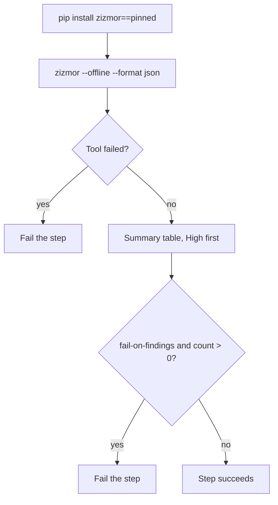

# `scan-workflows`

Scans GitHub Actions workflows, composite actions (`action.yml`) and `dependabot.yml` for security problems with [zizmor](https://github.com/zizmorcore/zizmor): script injection through `${{ }}`, excessive permissions, unpinned actions, credentials left in the checkout, dangerous triggers. It answers "is this workflow *safe*?"; correctness is [`lint-workflows`](../lint-workflows/README.md).

**Origin:** In-house composite action. zizmor is not an official or verified publisher under the [Actions policy](../../docs/contributing.md#actions-policy), so no Action wrapper is used: it is installed from PyPI at a pinned version. See [decisions.md](../../docs/decisions.md), rows "Workflow checks" and "Workflow checkers: supply chain".

## Inputs

| Name | Required | Default | Description |
|---|---|---|---|
| `paths` | No | `.github` | Space-separated files or directories (no spaces in the names). zizmor collects workflows, `action.yml` files and `dependabot.yml` from them. This repo passes `.github actions`. |
| `zizmor-version` | No | `1.30.1` | Exact zizmor version. Pinned so new releases or audit rules cannot change the result of an unchanged PR. |
| `fail-on-findings` | No | `false` | Fail the step when any finding is reported. Off by default (report only). |

## Outputs

| Name | Description |
|---|---|
| `finding-count` | Number of findings reported (suppressed findings are not counted) |

## How it works



zizmor runs **offline** with no token: the audits that need the GitHub API are skipped, so the scan has no network access and no credential to leak. `--no-exit-codes` keeps findings from changing the exit code, so a crash (bad path, broken YAML) is told apart from findings and always fails the step. Findings suppressed in the code with `# zizmor: ignore[rule]` are left out of the count.

## Usage

```yaml
- uses: ./actions/scan-workflows
```

```yaml
# This repo: workflows, dependabot.yml and all composite actions
- uses: ./actions/scan-workflows
  with:
    paths: ".github actions"
    fail-on-findings: true
```

## Known issues / Limitations

- **The default is report only**, although this repo's own baseline is now clean. The first run reported 71 findings (unpinned actions, `persist-credentials`, template injection in `detect-changes`, a Dependabot cooldown, broad workflow-level permissions); all were fixed, so `fail-on-findings` can be switched on without blocking anything.
- **Offline only.** The online audits (for example checking a pinned SHA against known tags, or known-vulnerable actions) are not run.
- **PyPI package pinned by version, not hash**, same as `codespell`.
- **Persona is `regular`.** The `pedantic` and `auditor` personas are not exposed.

## Related documentation

- [decisions.md](../../docs/decisions.md) — "Workflow checks", "Workflow checkers: supply chain"
- [workflows.md](../../docs/workflows.md) — actions overview and `check-workflows.yml`
- [zizmor audits](https://docs.zizmor.sh/audits/)
