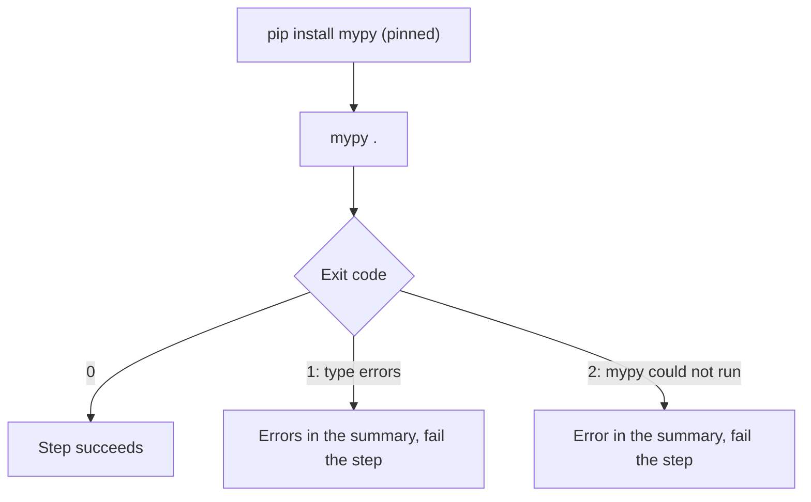

# `typecheck-python`

Type-checks Python code with [mypy](https://mypy-lang.org/). A blocking check: the step fails when mypy reports a type error, which is also listed in the job summary. The project's own mypy configuration (`mypy.ini`, `pyproject.toml`, `setup.cfg`) is respected.

**Origin:** In-house composite action that installs and calls the mypy CLI directly (not a wrapped GitHub Action) — allowed per the [Actions policy](../../docs/contributing.md#actions-policy) (official ecosystem tool). mypy is pinned to an exact version so a new release cannot change the result of an unchanged pull request.

## Inputs

| Name | Required | Default | Description |
|---|---|---|---|
| `working-directory` | No | `.` | Directory to run mypy in — one component's `path` from `detect-changes`' `components[]`. |
| `ignore-missing-imports` | No | `true` | Pass `--ignore-missing-imports`. The project's own dependencies are deliberately not installed (see below), so mypy cannot resolve third-party imports and would report each one as an error. |

## Outputs

This action produces no outputs; it succeeds or fails, and writes its findings to the job summary.

## How it works



## Usage

```yaml
- uses: ./actions/typecheck-python
  with:
    working-directory: backend
```

## Known issues / Limitations

- **Skipped without Python files.** A component that is only a dependency manifest (a `pyproject.toml`, `requirements.txt` or `Pipfile` with no `.py` next to it) has nothing to type-check; mypy itself would refuse to run (exit code 2). The step succeeds with a notice and a "Skipped" note in the summary. Found by running a test consumer that has such components.
- **The project's dependencies are not installed.** Installing them would run the pull request's own build code. The cost: calls into third-party libraries are not type-checked (their types are unknown). The project's own code and mypy config are fully checked. See [decisions.md](../../docs/decisions.md), row "`mypy` runs without the project's dependencies".
- **Verified locally** against a clean and a failing sample project; not yet run on a GitHub runner.

## Related documentation

- [workflows.md](../../docs/workflows.md) — actions overview and capability → CI mapping
