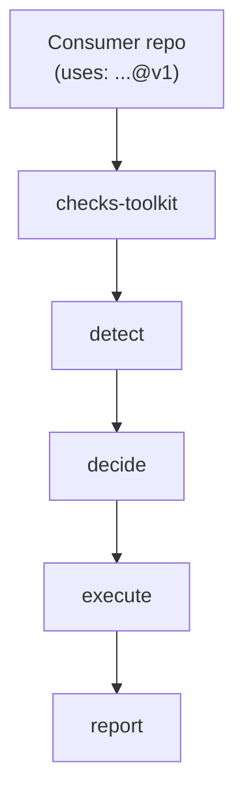
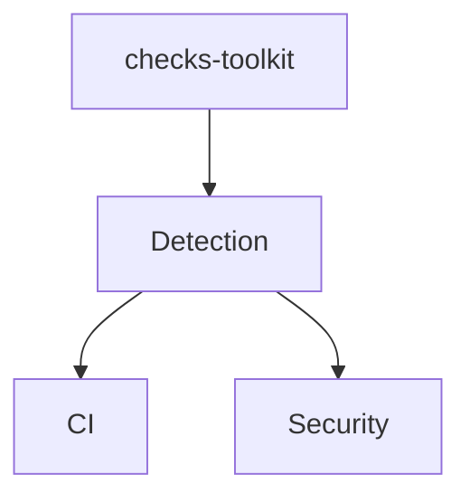

# Checks Toolkit — Architecture

This document is the short, current summary of the architecture. For the
reasoning behind each decision, see [decisions.md](./decisions.md). For what
is built, how well it is verified and what is next, see
[roadmap.md](./roadmap.md).

## Core principle

> Consumer repositories should not need to know how CI works. They only
> declare that they use the platform.



If a consumer repo needs to know *how* CI works (which tool, which job,
which condition), that knowledge belongs in `checks-toolkit`, not in the
consumer.

## Layers



- **Detection** — automatically determines which technologies are present
  in a repo (`project.*`) and what actually changed in a given PR/push
  (`changed.*`). See [workflows.md](./workflows.md) for the exact schema.
- **CI** — language/tool-specific checks (lint, typecheck, audit, scan, build — no code is executed to test it), only run
  when the relevant capability changed.
- **Security** — always-on / conditional / scheduled layers, see
  [security.md](./security.md).

  
## Repository and org structure

- Org: `ops-lane` — platform only (`checks-toolkit` +
  `checks-toolkit-test`)
- Reusable workflows can be called from other organizations and personal
  accounts, so consumer repositories do not have to live in `ops-lane`
- Default branch of `checks-toolkit`: `development` (deliberate choice,
  see [decisions.md](./decisions.md))

## Composite Actions vs. Reusable Workflows

| | Composite Action | Reusable Workflow |
|---|---|---|
| Use | A single reusable building block | A complete procedure/pipeline |
| Example | `actions/detect-changes` | `.github/workflows/ci.yml` |
| Call | `uses: ops-lane/checks-toolkit/actions/detect-changes@v1` | `uses: ops-lane/checks-toolkit/.github/workflows/ci.yml@v1` |

## Versioning

Consumer repos always pin to a tag, never to a moving branch ref
(`@development`). The project is pre-1.0, so releases are tagged `v0.x` and
the interface can still change; from `v1.0.0` breaking changes get a new
major version. See [roadmap.md](./roadmap.md).

## What a change looks like

The core claim, in two examples: only what is relevant runs, while the
checks that must always run, do.

```text
README.md change  → detect → Python = false, Node = false, Docker = false
                    → only Markdown checks run; the secret scan still runs
app.py change     → detect → Python = true
                    → Python checks run; the other capabilities are skipped
```

The platform is built in phases (foundation, CI, security, merge gate,
deployment, maturity); [roadmap.md](./roadmap.md) says where it stands.

## Non-goals

To avoid scope creep, we deliberately do **not** build, for now:

- Kubernetes orchestration
- Multi-cloud deployment
- Automatic production deployment
- Multiple runner pools
- Self-hosted GitHub Enterprise
- Complex policy engines
- Automatic code remediation
- Support for every programming language (MVP: only Python, Node, Docker, Terraform, Markdown)
- A standalone GitHub App for PR comments/ChatOps — plain GitHub Actions
  (`actions/github-script`, a thin `on: issue_comment` workflow) covers
  status updates and comment-triggered reruns without a second,
  always-online piece of infrastructure

This is not a permanent ban — these become relevant once Phases 1–4 are
proven to work.
