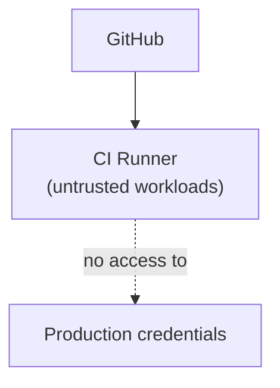
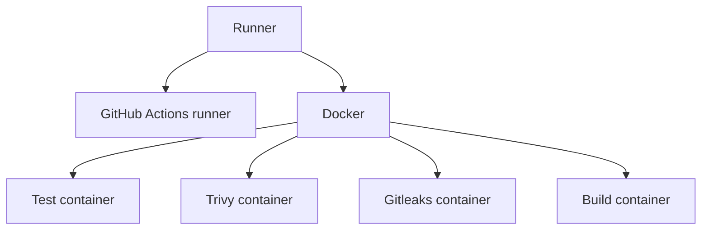

# Checks Toolkit — Runners

## Status

**Not in use yet.** The platform runs on GitHub-hosted runners today.
Self-hosted runners are a later, deliberate step (see
[roadmap.md](./roadmap.md)); the hosting location (home, VPS or other) and
the resources are undecided. A provisional, non-binding starting point is
4 vCPU / 8 GB RAM / 100 GB SSD. The architecture is kept ready for
self-hosted runners so introducing them does not need a redesign.

## Labels

```text
self-hosted
linux
ci
```

Later, separate:

```text
self-hosted
linux
deploy
```

## Trust model



The CI runner runs potentially untrusted code (from PRs). It must
therefore never be able to see production credentials. Deployment gets a
separate runner with its own trust boundary, relevant from Phase 5
onward.

## Ground rules

- Runner does not run as root
- Host is patched regularly
- SSH access is restricted
- Docker is configured carefully
- No permanent production credentials on the CI runner
- Fork PRs do not automatically run on the privileged runner
- Runners that run pull request code should be ephemeral (one job, then
  gone), so nothing a job leaves behind can affect the next one. Linting and
  Docker builds execute code from the pull request; see
  [security.md](./security.md#how-the-scans-run)
- CI and deploy runners are separated once production credentials are
  involved

## Tooling strategy

Don't pre-install all tooling on the host (avoids a "snowflake" runner).
Prefer running things via Docker/actions instead:


