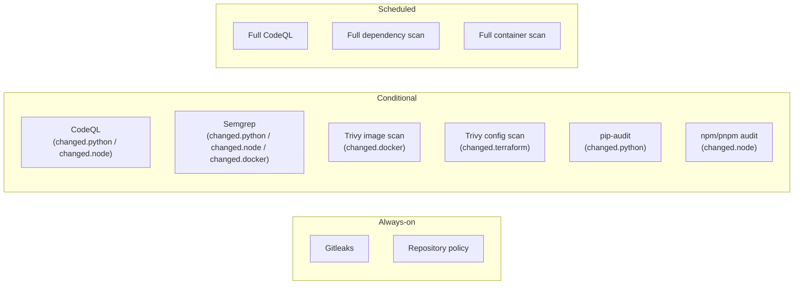
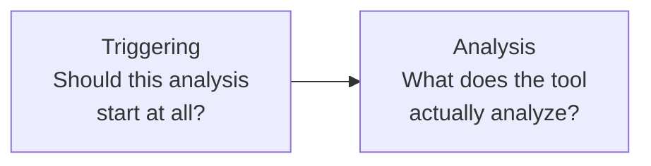

# Checks Toolkit — Security

## Three layers



- **Always-on**: runs on every PR/push, regardless of what changed.
  Reason: even a `.md`-only change could contain a secret.
- **Conditional**: only runs when the relevant capability changed.
- **Scheduled**: heavy/full scans, e.g. nightly, not on every PR. Planned,
  not built yet.

The always-on and conditional layers are the jobs of `security.yml`.
Quality checks (lint, typecheck, build) are in `ci.yml` and are not part
of this page.

## Trigger vs. analysis scope

For every tool we deliberately keep these two questions separate:



`changed.*` determines the **triggering**. It does not necessarily
determine the **analysis scope**: CodeQL, for example, analyzes the
codebase as a whole once it starts — it is not a linter that only needs
the changed files. See [workflows.md](./workflows.md#capability--ci-mapping)
for the breakdown per tool.

## Severity policy

| Severity | Action |
|---|---|
| CRITICAL | Block merge |
| HIGH | Block merge |
| MEDIUM | Report only |
| LOW | Report only |

Implemented as a `fail-on-severity` input (default `high`) on every action
whose tool reports a severity: `audit-node`, `scan-docker`,
`scan-terraform` and `scan-code`. `security.yml` has one input of the same
name and passes it to all of them. Each action applies the threshold itself
and lists every finding, blocking or not, in its job summary.

Tools that cannot grade findings:

- **`scan-secrets` (Gitleaks)** has no severity. A leaked secret is the one
  finding that always blocks.
- **`audit-python` (pip-audit)** has no severity field either, so it is all
  or nothing and defaults to report-only (`fail-on-findings`).

Each tool's own scale is mapped onto the four levels above — see
[decisions.md](./decisions.md), row "Severity policy in the security
actions", for the mapping (CodeQL score ranges, Semgrep levels, Trivy's
unfixed-vulnerability handling).

## How the scans run

The code being scanned comes from a pull request, so it is untrusted input
to the scanners.

- **Scanners run in throwaway containers** — official images pinned by
  version *and* digest: read-only mount, `--cap-drop ALL`,
  `no-new-privileges`, the runner's own (non-root) user, no tokens or
  secrets passed in. Trivy scans an image from a tar file instead of being
  handed the Docker socket (which would be root on the runner). Details and
  reasoning: [decisions.md](./decisions.md), row "Security tools run as
  pinned container images, not third-party Actions".
- **The scanned repository cannot configure its own scanner.** Gitleaks
  only uses the platform's config; a `.gitleaks.toml` or `.gitleaksignore`
  in a pull request is ignored, so a pull request cannot allow-list its own
  secret. Verified by test.
- **No dependency install scripts.** The Node lint and typecheck actions
  install the project's dependencies with `--ignore-scripts`; the audits
  read lockfiles only.
- **Nothing is uploaded and no secrets are shared.** Scans keep their
  results in the job summary; CodeQL's upload to code scanning is off by
  default because it needs `security-events: write`, which a fork pull
  request never has.
- **Known gap:** linting and Docker builds still execute code from the pull
  request (ESLint's config file, the Dockerfile's `RUN` steps). That is
  acceptable on ephemeral GitHub-hosted runners with a read-only token. It
  is a hard requirement to revisit before running public pull requests on
  self-hosted runners — see [runners.md](./runners.md).

## Supply chain: what runs, and how it is pinned

Every workflow in a consumer's repository that calls these ones runs code
from here, with that repository's token. So what *we* run has to be fixed
and reviewable.

- **Actions are pinned to a commit SHA**, with the version as a comment
  (`actions/checkout@3d3c… # v7.0.1`). A tag such as `@v7` can be moved by
  whoever controls the action's repository; a commit cannot. Dependabot
  proposes updates for both the workflows and `actions/*/action.yml`, with a
  one-week cooldown so a freshly published (possibly compromised) release is
  not among the first to be taken.
- **Container tools are pinned by digest** (Trivy, Gitleaks, Semgrep,
  lychee, ShellCheck) and **Python packages by exact version** (Ruff, mypy,
  pip-audit, codespell, yamllint, PyYAML, Poetry, pipenv). Dependabot cannot update these, so they are
  bumped by hand — [contributing.md](./contributing.md#pinned-versions) lists
  where they live.
- **Checkouts do not keep the token.** Every `actions/checkout` uses
  `persist-credentials: false`, so the token is not left in `.git/config`
  for later steps — which may run the pull request's own code — to read.
- **No expression is ever interpolated into a script.** Values reach
  shell scripts and `github-script` through `env:`, so they are data and
  never parsed as code. This matters most for file names from a pull
  request (`detect-changes` turns them into component paths). The rule and
  the incident that prompted it are in [decisions.md](./decisions.md), row
  "Untrusted values reach scripts only through `env:`".

## Verifying a release

A release is more than a tag. A release published by the current `Release`
workflow carries three files, and each file has a signed build provenance attestation, made by the
`Release` workflow with a short-lived identity from GitHub (no key to keep):

- `checks-toolkit-<tag>.tar.gz`: the source of exactly the tagged commit
- `checks-toolkit-<tag>.spdx.json`: an SBOM (a list of what the project is
  built from), taken from GitHub's dependency graph
- `SHA256SUMS`: the checksums of the other two

To check a download, with the GitHub CLI:

```bash
gh attestation verify checks-toolkit-v0.2.0.tar.gz --repo ops-lane/checks-toolkit
sha256sum --check SHA256SUMS
```

The first command proves the file was built by this repository's `Release`
workflow from this repository; the second that the three files belong
together. Releases are also immutable (files and tag cannot change after
publishing), which is why the files are attached to a draft that is published
only afterwards. `v0.1.0` predates this and has no files.

The repository also grades itself: the OpenSSF Scorecard workflow
(`scorecard.yml`) reports supply-chain practices such as branch protection,
pinned dependencies and token permissions to code scanning, and
`dependency-review.yml` blocks a pull request that adds a dependency with a
known high-severity vulnerability.

## Public repository and fork pull requests

Once the repository is public anyone can open a pull request, so the
question "what runs with what access?" has to have a deliberate answer.

| Trigger | Token | Secrets | Fork code runs? |
|---|---|---|---|
| `pull_request` | read-only for a fork | none for a fork | yes, in a box with nothing to steal |
| `pull_request_target` | read/write | yes | would run with full access: **dangerous** |

- The platform's workflows are meant for `pull_request`, `push` and
  `workflow_dispatch`. They **refuse to run** on `pull_request_target` (the
  `detect` job fails on purpose) rather than silently scanning the wrong code
  or running a fork's code with write access.
- The gate's pull request comment and the code scanning upload need write
  access, which a fork never gets. They are best-effort: the verdict and the
  job summary are always produced; only the comment is skipped.
- Pull requests from a fork also get no `platform-read-token`; the workflows
  fall back to the default token, which is enough once this repository is
  public.
- Secrets never belong in this repository's workflows; see below.

## Permissions: least privilege by default

```yaml
permissions:
  contents: read
```

Write permissions are only added explicitly per job when needed (e.g.
`pull-requests: write` for a job that posts a PR comment). This applies
from Phase 1 onward, not once security is "next in line" — see
[decisions.md](./decisions.md), row "Security foundation timing".

## Secrets

No secrets live in `checks-toolkit` itself. Secrets belong to the
consuming repository/environment (GitHub Environments: staging/
production). Preference for cloud deployments: OIDC instead of
long-lived credentials (relevant from Phase 5 onward, not built yet).

## Runner trust

See [runners.md](./runners.md) for the separation between CI and deploy
runners and the corresponding trust boundary.

## No standalone GitHub App for ChatOps

PR status updates and comment-triggered reruns can be done with plain
GitHub Actions (`actions/github-script`, a thin `on: issue_comment`
workflow). A standalone GitHub App adds a second, always-online piece of
infrastructure and is only worth it given a concrete reason — see
[architecture.md](./architecture.md#non-goals) for the full reasoning.
