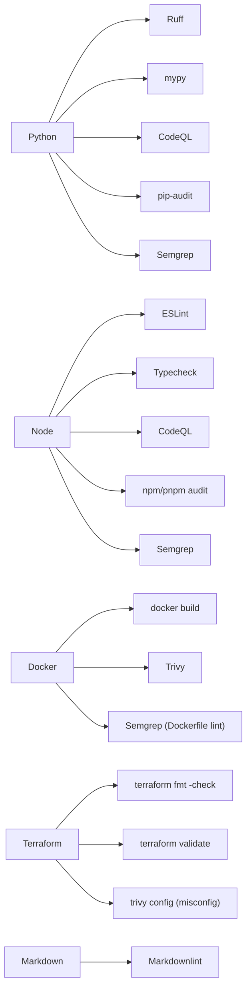
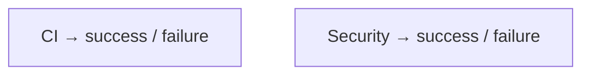
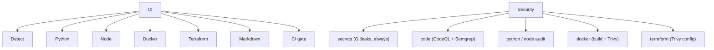
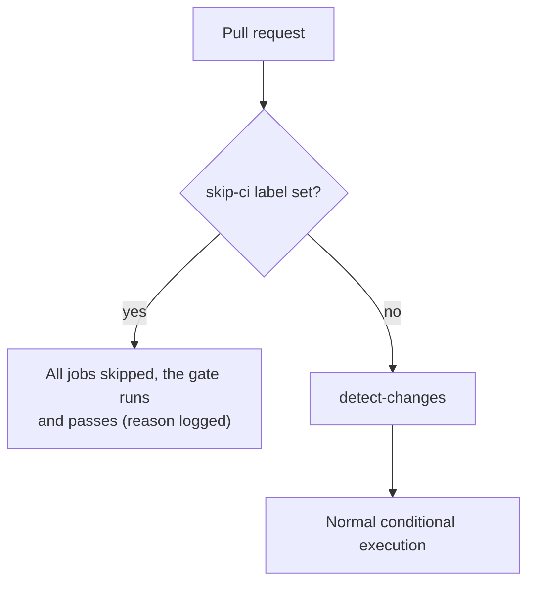
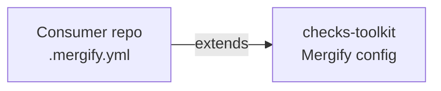

# Checks Toolkit — Workflow interface (technical contract)

This is the platform's API contract. Anything inside it may change freely
internally; anything outside it is a breaking change and requires a new
major version.

## Detection output schema

```json
{
  "project": {
    "python": true,
    "node": false,
    "docker": true,
    "terraform": true,
    "markdown": true
  },
  "changed": {
    "python": false,
    "node": false,
    "docker": false,
    "terraform": true,
    "markdown": true
  },
  "components": [
    { "path": "backend", "type": "python", "changed": false },
    { "path": "frontend", "type": "node", "changed": true }
  ]
}
```

`components` is in the schema from day one (even though the MVP doesn't
use it yet), so monorepo support later doesn't require a breaking schema
change. A later, non-MVP extension is a `capabilities` array per
component (e.g. `["lint", "typecheck"]`).

## Detection signals (MVP)

| Capability | Signals |
|---|---|
| Python | `pyproject.toml`, `requirements.txt`, `setup.py`, `Pipfile`, (weaker: `*.py`) |
| Node | `package.json`, `package-lock.json`, `pnpm-lock.yaml`, `yarn.lock` |
| Docker | `Dockerfile`, `compose.yml`, `docker-compose.yml` |
| Terraform | `*.tf` |
| Markdown | `*.md` |

No weighting in v1: any signal (weak or strong) sets the capability to
`true`. See [decisions.md](./decisions.md), row "`detect-changes` signal
matching (v1)".

## `detect-changes` action interface

Standalone-callable composite action (see
[contributing.md](./contributing.md#actions-policy)) — works whether
called from `ci.yml`/`security.yml` or on its own.

**Inputs** (both optional):

| Input | Default | Purpose |
|---|---|---|
| `base-ref` | Derived from `github.event_name`/`github.event` (PR base / previous push commit) | What to diff against |
| `head-ref` | `github.sha` | What to diff |

**Outputs**:

| Output | Type | Description |
|---|---|---|
| `result` | JSON string | Matches the [Detection output schema](#detection-output-schema) above in full — read it with `fromJSON(steps.<id>.outputs.result)` |

A single JSON output (rather than one flattened output per capability) so
adding a new ecosystem never changes the action's interface — see
[decisions.md](./decisions.md), row "`detect-changes` output shape".

## Capability → CI mapping



`pip-audit` and `npm`/`pnpm audit` are each capability's native SCA tool
(yarn is not supported yet). Docker's dependency exposure is covered by
Trivy's image scan, so it gets no separate SCA step. Terraform has no
dependency audit: OSV-Scanner, the planned fallback, cannot scan Terraform
at all — see [decisions.md](./decisions.md), row "`audit-terraform` /
OSV-Scanner for Terraform dropped". The platform does not run a
consumer's own tests — see row "No code-level tests in the platform".

**Semgrep** runs alongside CodeQL on Python/Node and on Docker (its
Dockerfile rules, inside `scan-code`) — see [decisions.md](./decisions.md), row
"Semgrep adoption". **Terraform misconfiguration** is covered by Trivy's
`trivy config` rather than a dedicated tool — see row "Terraform
misconfiguration scanning".

## Actions overview

Every action below lives at `actions/<name>/action.yml` in this repo,
named per the `<type>-<target>` convention in
[contributing.md](./contributing.md#naming). `ci.yml` calls the `lint-*`,
`typecheck-*` and `build-*` actions, `security.yml` the `audit-*` and
`scan-*` ones. Every action listed here is implemented and has its own
README in its folder; see each README for what has been verified and what
has not.

| Action | Type | Target | Tools inside | Implemented | Build approach |
|---|---|---|---|---|---|
| `detect-changes` | — | — | See [Detection output schema](#detection-output-schema) above | ✅ | Built in-house (see decisions.md) |
| `ci-gate` | — | — | Evaluates job results, builds the per-step result table (summary + PR comment), enforces the verdict; used by both the `CI gate` and the `Security gate` | ✅ | Built in-house — see decisions.md |
| `lint-python` | lint | python | Ruff | ✅ | Own CLI call — `pip install ruff` (or `uvx ruff`) + `ruff check`, no Action needed |
| `typecheck-python` | typecheck | python | mypy | ✅ | Own CLI call — pinned `pip install mypy`, project dependencies deliberately not installed. See [its README](../actions/typecheck-python/README.md) |
| `audit-python` | audit | python | pip-audit | ✅ | Own CLI call — `pip install pip-audit` + `pip-audit`, no Action needed |
| `lint-node` | lint | node | ESLint (the project's own) | ✅ | Own CLI call — dependencies installed with `--ignore-scripts`, then the project's ESLint. See [its README](../actions/lint-node/README.md) |
| `typecheck-node` | typecheck | node | tsc (the project's own) | ✅ | Own CLI call — dependencies installed with `--ignore-scripts`, then `tsc --noEmit`. See [its README](../actions/typecheck-node/README.md) |
| `audit-node` | audit | node | npm audit / pnpm audit (matching detected lockfile) | ✅ | Own CLI call — the package manager itself, lockfile only, nothing installed. See [its README](../actions/audit-node/README.md) |
| `build-docker` | build | docker | `docker build` | ✅ | Own CLI call — Docker is preinstalled on GitHub-hosted runners. See [its README](../actions/build-docker/README.md) |
| `scan-docker` | scan | docker | Trivy image scan | ✅ | Official Trivy container image, pinned by digest. See [its README](../actions/scan-docker/README.md) |
| `lint-terraform` | lint | terraform | `terraform fmt -check` (done) + `terraform validate` (not yet) | ✅ | Own CLI call — `hashicorp/setup-terraform@v4` (official, HashiCorp) just to install a pinned CLI version, then plain `terraform` commands. See [its README](../actions/lint-terraform/README.md) |
| `scan-terraform` | scan | terraform | Trivy config (misconfig) | ✅ | Official Trivy container image, pinned by digest. See [its README](../actions/scan-terraform/README.md) |
| `lint-markdown` | lint | markdown | markdownlint-cli2 + codespell + lychee | ✅ | Own CLI calls — `npx markdownlint-cli2`, `pip install codespell`, lychee via its Docker image; no Action needed. See [its README](../actions/lint-markdown/README.md) |
| `scan-secrets` | scan | secrets | Gitleaks (always-on) | ✅ | Official Gitleaks container image, pinned by digest. See [its README](../actions/scan-secrets/README.md) |
| `lint-commits` | lint | commits | A regular expression over `git log` (Conventional Commits) | ✅ | Own CLI call. Used by `check-commits.yml` on this repository's own pull requests, not by `ci.yml`. See [its README](../actions/lint-commits/README.md) |
| `lint-workflows` | lint | workflows | actionlint | ✅ implemented, not yet run on GitHub | Own CLI call — pinned release tarball, SHA-256 verified before use; no third-party Action. See [its README](../actions/lint-workflows/README.md) |
| `scan-workflows` | scan | workflows | zizmor (offline) | ✅ implemented, not yet run on GitHub | Own CLI call — `pip install zizmor==<pinned>`; no third-party Action. Scans workflows, composite actions and `dependabot.yml`. See [its README](../actions/scan-workflows/README.md) |
| `scan-code` | scan | code | CodeQL + Semgrep, one combined run across whichever languages are present — see [decisions.md](./decisions.md), row "CodeQL/Semgrep bundling" | ✅ | `github/codeql-action` (GitHub itself, pinned to a commit) + the official Semgrep container image, pinned by digest. See [its README](../actions/scan-code/README.md) |

The tools themselves run as official container images pinned by version and digest (not as third-party Actions) wherever that is possible — see [decisions.md](./decisions.md), row "Security tools run as pinned container images, not third-party Actions".

## `check-workflows.yml` (the platform checks itself)

`.github/workflows/check-workflows.yml` runs `lint-workflows` and
`scan-workflows` against this repo's own `.github/workflows`, `actions/`
and `dependabot.yml`. It is deliberately **not** part of `ci.yml`: if
`ci.yml` has a syntax error it never starts, so it cannot report its own
mistake. The checker therefore has its own trigger (a `paths:` filter on
`pull_request` and `push` to `development`, plus `workflow_dispatch`) and
does not use `detect-changes`. Only `actionlint` blocks; `zizmor` reports
until its known findings are resolved (see
[decisions.md](./decisions.md), row "Workflow checks").

Wiring `lint-workflows`/`scan-workflows` into `ci.yml` as a `workflows`
capability for consumer repos is a later step (needs a new
`detect-changes` signal) — see [roadmap.md](./roadmap.md).

## Workflow interface for consumer repos

```yaml
on:
  pull_request:
    # labeled/unlabeled: so adding or removing the skip-ci label starts a
    # new run. Without them the label only takes effect on the next push.
    types: [opened, synchronize, reopened, labeled, unlabeled]

permissions:
  contents: read

jobs:
  ci:
    permissions:
      contents: read
      actions: read          # the gate's result table reads the run's jobs
      pull-requests: write   # ... and posts/updates the PR comment
    uses: ops-lane/checks-toolkit/.github/workflows/ci.yml@v0.1.0
    with:
      platform-ref: v0.1.0   # must match the @ref above, see below
    secrets:
      platform-read-token: ${{ secrets.CHECKS_TOOLKIT_READ_TOKEN }}

  security:
    permissions:
      contents: read
      actions: read
      pull-requests: write
    uses: ops-lane/checks-toolkit/.github/workflows/security.yml@v0.1.0
    with:
      platform-ref: v0.1.0
    secrets:
      platform-read-token: ${{ secrets.CHECKS_TOOLKIT_READ_TOKEN }}
```

Things every caller has to know:

- **`platform-ref` is required and must equal the `@ref` in `uses:`.** A reusable workflow can't see which ref of itself it was called with, so it needs the value to check out its own actions (see `decisions.md`, row "Calling `ci.yml`'s actions from an external repo").
- **`platform-read-token`** is only needed while `checks-toolkit` is private: a token with read access to it (the caller's default token has none). Not needed once the repo is public.
- **Permissions** above are the minimum, granted on the calling job rather than the whole workflow (least privilege; `zizmor` flags the broad form): a called workflow can't get more than its caller grants, and the gate jobs request `actions: read` and `pull-requests: write` — a caller granting less has its whole run stopped at startup. The scans themselves only need `contents: read`.
- **Optional inputs.** `ci.yml`: `fail-on-findings` (fail on broken Markdown links). `security.yml`: `fail-on-severity` (default `high`; critical and high findings block, lower ones are reported), `fail-on-findings` (make `audit-python` fail, since pip-audit has no severity) and `codeql` (default `false`: CodeQL only works on a public repository or one with GitHub Advanced Security, so switch it on yourself; Semgrep always runs). Leaked secrets always block.
- **Two required checks.** Make `CI gate` and `Security gate` the required checks, not the individual jobs.
- **Trigger only on `pull_request`, `push` or `workflow_dispatch`.** Both workflows refuse to run on `pull_request_target` (they would run a fork's code with write access and secrets) — see [security.md](./security.md#public-repository-and-fork-pull-requests).

## Checks vs. outputs (important)

Workflow outputs (`workflow.outputs`) are not the same as GitHub checks.
Mergify evaluates PRs based on check runs/statuses, not on
`workflow.outputs`. The contract is therefore:

Consumer repositories get exactly two required checks:



Internally, these workflows may contain as many jobs as needed:



Mergify's required checks: only the two gate jobs (`CI gate`, `Security
gate`), never the individual sub-jobs — otherwise a skipped job would block
the merge. The gate jobs always run, even when everything else was skipped.

## Skip-CI label

A `skip-ci` PR label lets a maintainer deliberately override CI entirely,
including security (Gitleaks, CodeQL, Trivy, dependency scans). It is a
deliberate, full override — not a selective skip.

Design rules:

- The label always wins over change detection: `skip-ci` > detected changes.
- Both workflows check the pull request labels in their `detect` job. When
  the label is set, every other job is skipped through its `if:`; the gate
  job still runs. The gate is the required check, so it always starts and
  always finishes: a required check that never starts would stay "pending"
  forever and block the merge, which is the problem this design avoids.
- The skip reason is shown visibly in the gate's job summary and PR comment
  ("skipped via skip-ci label … a green check here does NOT mean the change
  was tested"), so a green check is never mistaken for "tested".
- Only the `pull_request` event can skip. A push or a manual run never does.
- The consumer's `pull_request` trigger must list the `labeled` and
  `unlabeled` types (see the snippet above), otherwise adding the label does
  not start a new run until the next push.
- Because `skip-ci` also skips security, only maintainers may set the
  label — this prevents contributors from bypassing security checks
  themselves. Setting that restriction is a repository/Mergify setting; the
  workflow cannot enforce it.
- Mergify can also use this label directly as a merge condition,
  separate from the individual required checks, as an extra explicit
  override.



## Mergify configuration

```yaml
# in a consumer repo's .mergify.yml
extends: ops-lane/checks-toolkit
```



The actual `pull_request_rules`/`queue_rules` live centrally in
`checks-toolkit` (Phase 4, see [roadmap.md](./roadmap.md)). Still to verify before
implementation: whether Mergify's shared/extended configuration feature
still works as expected under the current plan.
